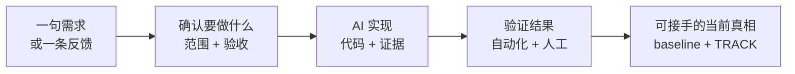
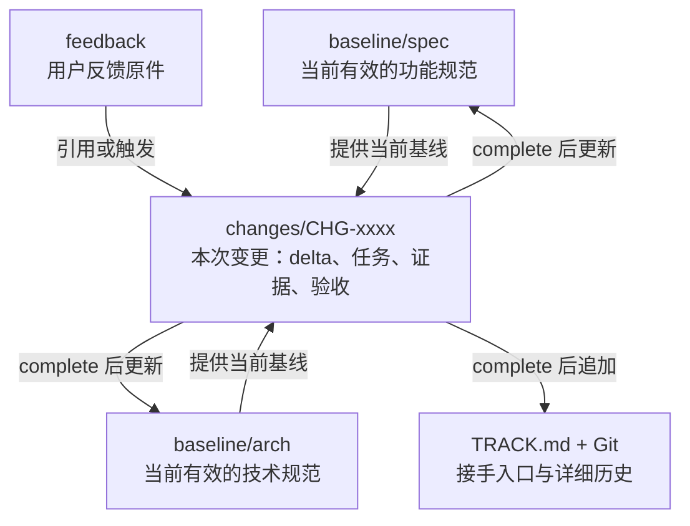
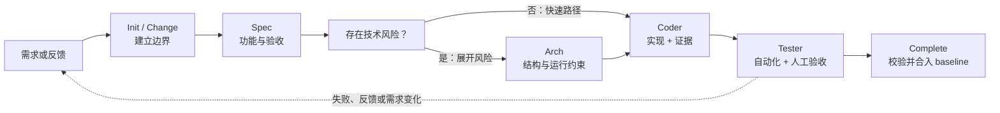
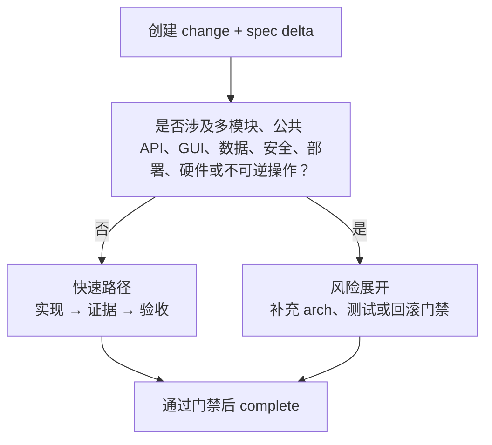
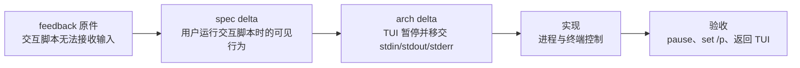

# AZ-SDD 分享讲稿：把一句需求变成可接手的软件交付

> 面向：产品、开发、测试、架构与使用 AI 编程助手的团队
> 时长：30～45 分钟
> 当前范围：AZ-SDD V4.2；默认由 Git 保存历史，不默认维护 `archive/`

**一句话价值：**AZ-SDD 让人确认目标与风险，让 AI 围绕已批准的规范实现并留下证据；完成后，下一位人或 AI 能直接读到当前真相。



## 这场分享结束时，听众应该带走什么

1. 能区分功能规范、技术规范和用户反馈，不再把它们混成一堆“归档文档”。
2. 能说明一项变更中，哪些决定必须由人做，哪些工作可以交给 AI 展开。
3. 能用后面的现场提示词，从空目录演示一个带 GUI 的计算器如何按 AZ-SDD 开发并验收。

---

## 30 秒先看：AZ-SDD 如何开始

不要把现场演示开场放在“请 AI 写一个计算器”。推荐按下面的顺序进入：

```text
/az-sdd-init
/az-sdd-spec 为 CHG-0001 创建功能规范增量
/az-sdd-arch CHG-0001
/az-sdd-coder CHG-0001
/az-sdd-tester CHG-0001
/az-sdd-track complete CHG-0001
```

这不是每个任务都要机械执行六个命令：简单任务可以快速通过，涉及 GUI、公共接口、数据、安全、部署或硬件的任务会展开技术与验证门禁。关键是每一步都有明确输入、可见输出和负责人。

---

## 1. 为什么 AI 写得快，交付却可能更慢

AI 能迅速补全代码，但它并不知道哪些假设是允许的。若没有稳定契约，常见结果是：

| 现场现象 | 根因 | AZ-SDD 的处理方式 |
| --- | --- | --- |
| AI 把需求做“大了”或做“偏了” | 目标、非目标没有被确认 | 用 spec 明确范围、非目标和验收 |
| 代码局部能运行，整体却不符合系统边界 | 技术取舍没有被显式确认 | 风险触发时补充 arch |
| 测试全绿，用户仍不能使用 | 测试没有映射到用户验收 | 人工逐项证明结果 |
| 换人后不知道当前以哪份文档为准 | 当前状态与过程历史混在一起 | baseline 保存当前真相，TRACK + Git 提供追溯 |

AZ-SDD 不承诺“AI 永不出错”。它要求错误、假设和反馈都落在可发现、可回写、可验证的位置上。

---

## 2. AZ-SDD 的核心：三类制品，一次变更

### 2.1 不要把 spec、arch、feedback 混在一起

| 制品 | 回答的问题 | 当前保存位置 | 主要责任人 |
| --- | --- | --- | --- |
| 功能规范 `spec` | 用户要得到什么？边界是什么？怎样验收？ | `baseline/spec/` | 产品 / 业务 / 测试确认，AI 整理 |
| 技术规范 `arch` | 如何在系统中正确实现？有哪些运行与技术约束？ | `baseline/arch/` | 架构 / 技术负责人确认，AI 分析与展开 |
| 用户反馈 `feedback` | 用户遇到了什么问题？期望如何变化？ | `feedback/` | 用户 / 支持 / 产品记录与确认 |
| 本次变更 `change` | 这一次要怎样把规范改变为新状态？ | `changes/<CHANGE_ID>/` | 本次变更参与者 |



**分享时可直接说：**

> feedback 是问题事实；spec 是用户可见行为；arch 是技术约束。它们都是长期有价值的内容。change 不是第四类规范，而是把这三者带过一次安全变更的工作单。

### 2.2 什么叫“当前真相”

完成一项 change 后：

- spec delta 合入 `baseline/spec/`；
- arch delta 合入 `baseline/arch/`；
- `TRACK.md` 追加这次变更的入口；
- 开放 change 清理；
- 默认由 Git 保存详细历史。

因此接手者先读 baseline 和 TRACK，就能知道当前软件已经承诺了什么，而不必在旧的 change 或 archive 中猜测哪份内容仍然有效。

---

## 3. 开发流程：人负责决策，AI 负责展开与留证



| 环节 | 人要做的事 | AI 要做的事 | 可见结果 |
| --- | --- | --- | --- |
| 需求 / 反馈 | 给出目标、业务背景、优先级；回答澄清问题 | 复述理解，暴露歧义与风险 | 原始需求或 feedback |
| Spec | **批准**范围、非目标、验收条件 | 把自然语言整理为可审核、可测试的功能契约 | spec delta |
| Arch（按需） | **批准**技术取舍与风险控制 | 分析影响面，提出结构、接口、运行和验证方案 | arch delta |
| Coder | 处理阻塞，参与代码审查 | 只按批准 change 实现；记录代码与测试证据 | 实现、tasks、evidence |
| Tester | **亲自执行或确认**人工体验和业务验收 | 复用自动化证据，生成步骤，记录通过或失败 | acceptance |
| Complete | **确认**变更可成为当前真相 | 校验门禁、合并 delta、更新 TRACK；失败自动回滚 | baseline、TRACK、Git 历史 |

一句话总结人机分工：

> 人决定“是否正确、是否接受、是否承担风险”；AI 负责“把已确认的意图展开、实现并留下证据”。

### 3.1 arch 为什么不是每次必经站



这避免两个极端：任何小改动都要写长文档，或任何复杂改动都直接让 AI 开写。

---

## 4. 真实案例：azKits 怎样把反馈带回正确的位置

### 产品任务

azKits 是 Windows 离线终端脚本工具箱。它让测试人员通过 YAML 入口发现和运行 BAT、PowerShell、Python、Shell 或 EXE 脚本，并查看执行状态和日志。

它非常适合说明 AZ-SDD，因为它同时有：

- **功能问题：**用户如何选择脚本、启动脚本、查看结果？
- **技术问题：**YAML、TUI、子进程、终端输入输出如何隔离？
- **真实反馈：**脚本需要 `pause` 或标准输入时，TUI 应如何把终端交回给脚本？

### 从模糊目标到可验收行为

初始想法：“把分散的脚本统一到一个离线工具入口。”

Spec 将它收敛为用户能够验证的结果：

- 只展示当前 YAML 入口中声明且启用的脚本；
- 用户能看到脚本名称、简介、执行状态和日志；
- 用户确认后才运行真实脚本；
- 配置缺失、脚本失败、用户取消都有明确提示；
- 工具不解释任意自由命令，也不扫描脚本内容猜测含义。

这一步让 AI 不会把“工具箱”擅自实现成任意 GUI、任意命令执行器，或脱离真实脚本的模拟器。

### 真实反馈闭环：交互脚本无法接收输入

反馈事实：“BAT 运行到 `pause` 时需要用户按键，但 azKits 的 TUI 占着终端，脚本无法可靠接收输入。”



这里最重要的不是“修了一个 pause”。而是所有人以后都能知道：用户遇到过什么问题、产品现在承诺什么行为、技术上为何这样实现、如何验证过。

---

## 5. 现场演示：从一句话做出带 GUI 的计算器

### 演示目标与边界

用一个空目录完成最小闭环：不是展示“AI 30 秒写出计算器”，而是展示 AI 如何先问清、再实现、再让人验收。

演示项目：

```text
C:\demo\az-sdd-calculator
```

第一期功能范围：

- 两个十进制数的加、减、乘、除；
- GUI 输入、选择运算、显示结果、清空；
- 处理除数为 0、空输入、非法输入；
- 不做括号表达式、历史记录、科学计算、联网、账号或持久化。

### 5.1 初始化：只建立档案，不写代码

```text
/az-sdd-init
```

**现场展示：**项目档案已建立，默认历史策略为 `history.mode=git`。此刻尚未生成任何业务功能，AI 只是准备好承接可追踪的变更。

### 5.2 现场提示词一：先得到可批准的功能规范

```text
/az-sdd-spec

创建功能规范增量：我要做一个本地桌面 GUI 计算器。

第一期只支持：
- 两个十进制数的加、减、乘、除；
- 用户可输入两个数并选择运算；
- 显示结果；
- 除数为 0、输入为空或不是数字时给出明确提示；
- 支持清空并继续下一次计算。

第一期不做：括号表达式、历史记录、科学计算、联网、账号与数据持久化。
规范中必须给出可执行的验收条件，以及自动化测试与人工验收的划分。
```

**此处必须由人回答并批准：**

- 是否允许负数？结果保留几位小数？
- 点击“计算”与按 Enter 是否都触发？
- 错误提示后是否保留用户输入？
- 窗口关闭后是否需要保留状态？

分享重点：AI 在这一步不应编码；它应把模糊需求变成能被产品、开发和测试共同确认的契约。

### 5.3 现场提示词二：让 GUI 风险触发 arch

GUI 即使功能简单，也涉及框架选择、事件模型、输入校验和测试策略。不要假定技术栈，先让 AI 给出方案：

```text
/az-sdd-arch CHG-0001

请基于已批准的计算器 spec delta，分析本次变更的技术风险。
至少说明：
- 可用的 GUI 技术栈候选及推荐理由；
- 窗口、输入、运算服务、错误提示的职责边界；
- 如何避免 GUI 事件处理和计算逻辑耦合；
- 自动化测试如何覆盖四则运算和错误输入；
- 哪些验收必须人工查看界面完成。

先给出技术方案与待确认项；不要写代码。
```

**人的决定：**选一个现场已经可运行的技术栈，例如 Python + Tkinter，或团队已有的桌面框架。不要在分享现场首次安装未知依赖。

### 5.4 现场提示词三：按已批准 change 实现并留证

```text
/az-sdd-coder CHG-0001

按已批准的 spec delta 和 arch delta 实现桌面 GUI 计算器。
要求：
- 先列出会创建或修改的文件及其职责；
- 先实现独立的计算与输入校验逻辑，再接入 GUI；
- 为四则运算、除数为 0、空输入、非法输入编写自动化测试；
- 运行测试并把命令、结果、关键代码差异写入 evidence；
- 遇到规范未定义的行为时停止并提问，不自行扩展范围。
```

**你要观察 AI 是否做到：**

- 只实现批准范围，不偷偷加入历史记录或科学计算；
- 将可计算逻辑与按钮事件分开，便于测试；
- 给出真实测试结果，而不是只说“应该可以”；
- 未定义行为先提问，而不是替人做产品决定。

### 5.5 现场提示词四：让用户行为决定验收结果

```text
/az-sdd-tester CHG-0001

请依据 CHG-0001 的 acceptance 执行验收：
- 复用自动化测试证据；
- 启动 GUI；
- 分别验证加、减、乘、除；
- 验证除数为 0、空输入、非法输入；
- 验证清空后可继续计算；
- 人工检查错误提示是否清晰、窗口是否可关闭、界面是否可操作。

逐项记录通过、失败或阻塞的证据；任何失败都不要标记通过。
```

此刻演示者应亲自操作界面。AI 可以执行、记录和提示，但不能替用户宣布“界面体验已通过”。

### 5.6 最后一步：complete 让变更成为当前真相

所有验收通过，并由演示者确认后：

```text
/az-sdd-track complete CHG-0001
```

| 你看到什么 | 它说明什么 |
| --- | --- |
| spec delta 合入 `baseline/spec/` | 当前产品行为已更新 |
| arch delta 合入 `baseline/arch/` | 当前技术边界已更新 |
| `TRACK.md` 新增 CHG-0001 | 后续接手有入口 |
| 开放 change 被清理 | 工作过程不再被误认为当前规范 |
| Git 保存详细提交历史 | 默认不需要再维护 archive |

---

## 6. 推荐的 30 分钟现场节奏

| 时间 | 动作 | 观众应看到的结论 |
| --- | --- | --- |
| 0～3 分钟 | 给出“GUI 计算器”一句需求 | 原始需求天然不完整 |
| 3～8 分钟 | `/az-sdd-spec`，人工回答并批准 | spec 让范围、异常和验收可确认 |
| 8～12 分钟 | `/az-sdd-arch`，选择 GUI 方案 | 技术选择由风险触发，且由人确认 |
| 12～22 分钟 | `/az-sdd-coder` | AI 按批准内容实现并留下自动化证据 |
| 22～28 分钟 | `/az-sdd-tester`，人工操作界面 | 跑绿不等于交付，用户验收才给结论 |
| 28～30 分钟 | `/az-sdd-track complete CHG-0001` | 当前真相更新，下一位参与者能接手 |

如果构建或 GUI 启动时间不可控，可以预置一个干净的“已完成 coder、待 tester”状态；但要明确告诉观众哪些步骤现场执行、哪些是预置状态，不能伪造测试或验收。

---

## 7. 分享前检查清单

- [ ] AZ-SDD 九个技能已经安装，新会话能识别 `/az-sdd-init` 等命令。
- [ ] GUI 技术栈和运行环境已提前验证；现场不首次安装依赖。
- [ ] 演示目录为空，或已准备可还原快照。
- [ ] 演示者拥有 spec、arch 和最终验收的批准权。
- [ ] 已准备“除数为 0”和“非法输入”两条失败路径。
- [ ] 若网络、GUI 或构建耗时不可控，已准备中间检查点，并明确标识预置部分。

## 最后一句

> **让规范成为 AI 的输入，让代码和测试成为可回写的证据，让每一次 change 完成后都留下可接手的当前真相。**

## 参考资料

- `C:\JPZ_Workspace\AZ_TOOLS\azSdd\shared\references\v4-artifact-model.md`
- `C:\JPZ_Workspace\AZ_TOOLS\azSdd\docs\workflow.md`
- `C:\JPZ_Workspace\AZ_TOOLS\azSdd\docs\usage.md`
- `C:\JPZ_Workspace\笔记仓库-jpz\hq-jpz\AZ-SKILLS\docs\az-sdd实战案例分享\projects\azKits\README.md`
