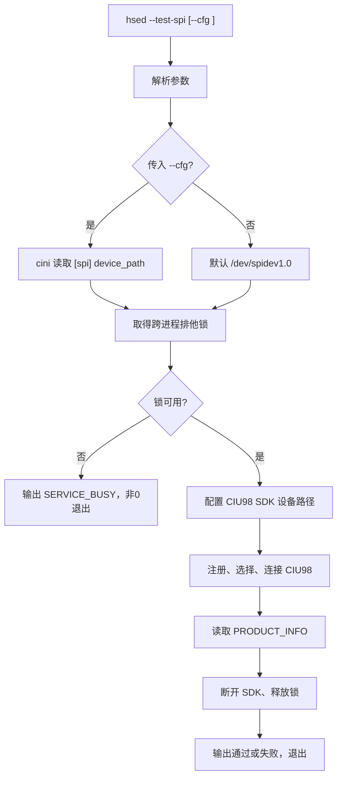

# 技术规范：0003 HSED SPI 设备通信自检指令

## 基本信息

| 字段 | 内容 |
|---|---|
| 规范编号 | 0003 |
| 所属模块 | HSED 命令行工具 |
| 关联功能 | 0003 SPI 设备通信自检指令 |
| 创建日期 | 2026-07-20 |
| 更新日期 | 2026-07-27 |
| 状态 | 已批准；2026-07-27 已完成代码实现和交叉构建，待目标机设备验收 |

## 概述

本规范定义 `hsed --test-spi` 的实现边界。该模式是独立的一次性 CIU98 SPI 通信自检程序：不初始化 SPC 服务、不加载业务服务组件；它取得 CIU98 的独占访问权后，完成安全的只读连接和产品信息读取，再释放资源并退出。

> 阅读规则：正文描述已批准的目标实现；文末“当前代码逆向基线”描述
> 2026-07-27 的真实代码行为。两者冲突时，产品实现应补齐目标设计，复现现有版本时
> 才按逆向基线保留限制。

## 关联功能与验收来源

| 来源 | 内容 |
|---|---|
| 功能规范 | `az-sdd/spec/0003-hsed-SPI设备通信自检指令.spec.md` |
| 功能目标 | 验证 HSED 所选 SPI 设备能与 CIU98 完成真实通信 |
| 验收标准 | [001] 至 [009]；本规范只定义实现与验证入口，不改变验收口径 |

## 技术选型

### 选型对比

| 层级 | 选项 A | 选项 B | 选择 |
|---|---|---|---|
| CIU98 通信验证 | 原始 `spidev` 随机/回环数据 | CIU98 Host SDK 的连接和信息读取 | 选择 Host SDK |
| 配置读取 | 手工解析 INI | 现有 `cini` 组件的 `TCIni` 接口 | 选择 `TCIni` |
| 正常服务与自检互斥 | 仅检查进程名 | 同一把跨进程排他锁 | 选择跨进程排他锁 |

### 最终决策

| 层级 | 技术 | 选择理由 |
|---|---|---|
| 语言与构建 | 现有 C/CMake | 与 HSED 当前工程和目标系统一致，不引入新依赖 |
| CIU98 SDK | 仓库内 `vendor/ciu98/sdk` | 供应商示例已提供 SPI 注册、选择、连接和信息读取的可用调用顺序 |
| 真实通信判定 | `api_register -> api_select -> api_connect -> api_get_info(PRODUCT_INFO) -> api_disconnect` | 产品信息读取是只读操作；连接响应和产品信息成功返回共同证明真实芯片通信 |
| SPI 参数 | Mode0、8 bit、4.8 MHz | 与供应商 Linux 端口层当前 `SPI_SPEED=4800000` 和 CIU98 Mode0 要求一致；设备节点为 `/dev/spidev1.0` |
| 配置 | `--cfg <ini路径>`；未传入时直接使用 `/dev/spidev1.0` | 满足显式配置与无配置默认使用两种场景，避免隐式寻找配置文件 |
| 服务互斥 | `flock` 保护同一锁文件 | 不依赖外部服务，且可防止正常 HSED 服务与自检同时操作同一 CIU98 |

### 许可证检查

| 检查项 | 结果 |
|---|---|
| 新增第三方依赖 | 无 |
| 现有 `cini` | 项目内现有组件 |
| CIU98 SDK | 随项目提供的供应商 SDK；按项目既有供应商软件许可使用 |

## 架构设计



### 模块划分

| 模块 | 职责 | 关键接口/数据 |
|---|---|---|
| `common/main.c` | 解析 `--test-spi` 与 `--cfg`；分派自检或既有正常启动路径 | `main(argc, argv)` |
| 自检控制模块 | 读取配置、管理流程、映射失败阶段和退出码 | `HsedSpiSelfTestRun(cfg_path)` |
| 配置适配模块 | 当存在 `--cfg` 时用 `TCIniCreate` / `TCIniGetKeyValueStringEx` 读取 `[spi] device_path` | 最大路径长度受限的 NUL 结尾字符串 |
| CIU98 SDK 适配模块 | 在 SDK 初始化前设置目标 SPI 设备路径；执行只读连接和信息读取；确保收尾断开 | 设备路径、SDK 返回码、产品信息 |
| 跨进程锁模块 | 正常 SPC 服务与自检共用的独占锁；进程退出时释放 | `flock` 锁文件描述符 |
| 正常 HSED 服务 | 在首次接触 CIU98 前获取同一独占锁，在退出时释放 | 与自检互斥，但不加载到自检模式 |

### 命令行与配置约定

| 项目 | 约定 |
|---|---|
| 自检命令 | `hsed --test-spi` |
| 指定配置 | `hsed --test-spi --cfg <ini路径>` |
| INI 节/键 | `[spi]` / `device_path` |
| 未传 `--cfg` | 不读取 INI，直接使用 `/dev/spidev1.0` |
| 传入无效 `--cfg` | 配置错误并以非 0 退出；不回退默认路径 |
| 不带 `--test-spi` | 保持既有正常 HSED 启动路径 |
| 参数错误 | 显示用法并以非 0 退出 |

### CIU98 SDK 适配

1. 在调用 `api_register` 前，将当前自检选定路径写入供应商 Linux 端口层的运行时设备路径；不得依赖其静态默认设备路径。
2. 为供应商端口层增加受限的设备路径设置函数，只接受绝对路径、拒绝空字符串和超长字符串；SDK 已初始化或有活动连接时拒绝修改路径。
3. 调用顺序严格为：`api_register(PERIPHERAL_SPI, SPI_PERIPHERAL_SE0)`、`api_select(...)`、`api_connect(...)`、`api_get_info(PRODUCT_INFO, ...)`、`api_disconnect()`。
4. 任一失败均停止后续步骤；若已经连接或注册，仍执行可安全执行的断开/释放。
5. 禁止调用供应商 `all_api_test.c` 中的 `auth_test`、`key_test`、`crypto_test`、`ctrl_test`、`fs_test`、`update_test`；`comm_test` 中的复位与原始收发测试不作为自检通过条件。

### 服务互斥

1. 自检进程和正常 HSED SPC 服务都使用同一锁文件 `/tmp/hsed-ciu98.lock`，以 `open(..., O_CREAT | O_CLOEXEC, 0660)` 后的非阻塞 `flock(LOCK_EX | LOCK_NB)` 取得独占权。
2. 取得失败时，自检返回 `SERVICE_BUSY`；不得打开 SPI、复位芯片或调用 CIU98 SDK。
3. 正常服务在初始化 CIU98 前取得锁并在服务退出后释放；自检在完成或任意失败路径中断开 SDK、关闭锁文件后退出。
4. 锁仅保护本机 HSED 对 CIU98 的访问，不替代设备节点权限控制；设备部署时仅授予 HSED 访问 `/dev/spidev1.0` 与所需 RST GPIO 的权限。

### 退出码与日志

| 退出码 | 阶段 | 输出要求 |
|---|---|---|
| 0 | 通信通过 | 显示设备路径、连接响应长度和“CIU98 通信自检通过” |
| 2 | 参数错误 | 显示用法或缺失的 `--cfg` 参数 |
| 3 | 配置错误 | 显示 INI 路径及缺失/读取失败/键值错误原因 |
| 4 | 服务占用 | 显示 `SERVICE_BUSY`，不访问 SPI |
| 5 | SPI/SDK 初始化失败 | 显示设备路径、失败阶段和供应商错误码 |
| 6 | CIU98 连接失败 | 显示连接失败或超时及供应商错误码 |
| 7 | 产品信息读取失败 | 显示读取失败及供应商错误码 |

日志只记录设备路径、阶段、SDK 错误码、响应长度和耗时；不得输出密钥、认证数据、原始敏感业务数据或完整芯片标识内容。

## 构建与部署架构

1. CMake 将 HSED 目标名和源文件列表从现有模板残留中整理为 HSED 自身源码，并显式纳入 CIU98 SDK Linux 端口层、API/命令/协议/工具源码及 HSED 自检模块。
2. 编译时包含供应商 SDK 的 `port/linux`、`src/app/api`、`src/app/cmd`、`src/driver`、`src/util` 头文件目录；不引入新的第三方库。
3. 自检与正常服务复用同一 HSED 可执行文件，使用命令行分支区分；自检模式不链接或初始化 SPC 生成服务对象。
4. 部署目标为 AG35 Linux；CIU98 接 AG35 SPI2，对应 Linux 节点 `/dev/spidev1.0`。

## 运行与验证条件

| 项目 | 内容 |
|---|---|
| 启动方式 | `hsed --test-spi`；指定 INI 时 `hsed --test-spi --cfg <ini路径>` |
| 正常服务启动 | 不带 `--test-spi` 时沿用正常 HSED 服务入口 |
| 关闭方式 | 自检自动断开 CIU98、释放锁并退出；正常服务响应 SIGTERM/SIGINT 后释放锁 |
| 自动验证入口 | 主机侧测试参数解析、INI 读取、默认值、错误映射和锁占用分支；CIU98 SDK 调用通过可替换适配层 mock 验证 |
| 人工验收前置条件 | AG35 已生成 `/dev/spidev1.0`；CIU98 已连接；测试期间正常 HSED 服务未运行；如使用 `--cfg`，INI 可读且包含 `[spi] device_path` |
| 设备侧验证入口 | 在 AG35 shell 执行 `hsed --test-spi`，验证真实 CIU98 通信；再以 `--cfg` 验证配置路径和失败分支 |

## 风险与决策

| 风险/决策 | 影响 | 处理方式 |
|---|---|---|
| 供应商 SDK 默认设备路径为静态字符串 | `--cfg` 无法生效或误访问错误节点 | 增加初始化前的受限运行时设备路径设置函数，并纳入自动化测试 |
| 两个 HSED 进程同时操作 SPI | 协议状态混乱、复位干扰、通信结果不可信 | 统一非阻塞跨进程锁，失败即退出 |
| 实例参考包含高风险功能 | 可能写密钥或改变芯片状态 | 仅复用注册、选择、连接、产品信息读取和断开顺序 |
| `/dev/spidev1.0` 权限不足 | 自检无法打开设备 | 输出实际路径和系统错误；部署时配置最小设备权限 |
| 供应商样例编码异常 | 直接复制会引入不可读日志或不安全测试逻辑 | 按 API 调用语义实现 HSED 自检，不复制样例的测试代码 |

## 备注

- 本规范不定义新的 HSED SPC 接口，不改变现有对外加密、解密、签名或公钥管理功能。
- 0003 功能规范与本技术规范已审核批准，可进入 `/az-sdd-coder 0003` 的编码计划确认阶段。

## 当前代码逆向基线（2026-07-27）

### 实际调用链

```text
main
  -> 仅检查 argv[1] 是否为 "--test-spi"
  -> L_GetCfgPath 扫描首个 "--cfg" 的下一参数
  -> HsedConfigInit
  -> TCIni 读取 [bsc_hse] vendor_so_path
  -> RteHseSelfTest
  -> dlopen(RTLD_NOW | RTLD_LOCAL)
  -> dlsym("BscHseVendorSdkApi")
  -> dlsym("BscHseVendorTest")
  -> BscHseVendorTest
  -> api_register
  -> api_select
  -> api_connect
  -> api_get_info(CHIP_ID)
  -> api_disconnect
  -> dlclose
```

### 当前精确行为

| 项目 | 当前实现 |
|---|---|
| 配置文件 | 未传有效 `--cfg` 时读取 `/etc/hsed.ini` |
| 必需键 | `[bsc_hse] vendor_so_path`，最大 256 字节；空值失败 |
| SPI 路径 | 自检有 `--cfg` 时由 `TCIni` 读取 `[spi] device_path`，无 `--cfg` 时固定默认 `/dev/spidev1.0`；RTE 调用 `BscHseVendorConfigure()`，CIU98 port 在打开前使用该路径 |
| 自检隔离 | 不调用 `BscHseInit`，不启动 SPC；只加载 vendor 动态库并调用测试符号 |
| 成功判定 | `api_get_info(CHIP_ID)` 返回成功 |
| 输出 | app 记录实际 SPI 路径、通过/失败和统一结果码；vendor SDK 阶段、原始错误码和响应长度尚未回传 |
| 退出码 | 已实现 0（成功）、2（参数）、3（配置）、4（SERVICE_BUSY）、5（其他 SDK/设备失败）；尚未细分为 6/7 |
| 参数容错 | 仅接受 `hsed --test-spi [--cfg <ini路径>]`；缺参、重复或未知参数显示用法并退出 2；正常服务仅接受无参或 `--cfg <ini路径>` |
| 进程互斥 | RTE Linux 边界使用非阻塞 `/tmp/hsed-ciu98.lock`；正常服务持有至 `RteHseDone`，自检结束即释放。SFC 仅提供进程内临界区，未把 POSIX 锁扩散进 BSC |
| 退出 GPIO | 未实现；由草稿 0010 后续处理 |

### 与目标设计的必须修复项

1. 已完成配置模块 `[spi] device_path`：显式配置无效不回退、未指定使用默认值；
2. 已通过 vendor/RTE 配置契约把设备路径传到 CIU98 port；
3. 已在首次硬件访问前取得同一跨进程排他锁；
4. 已严格校验参数位置、重复项和缺失值，实现 0/2/3/4/5；仍需按 vendor 阶段细分 6/7；
5. 尚需记录 vendor 失败阶段、SDK 原始错误码和响应长度，但不得输出完整 CHIP_ID；
6. 自检的所有可控退出路径仍待接入 0010 批准后的低功耗清理。
