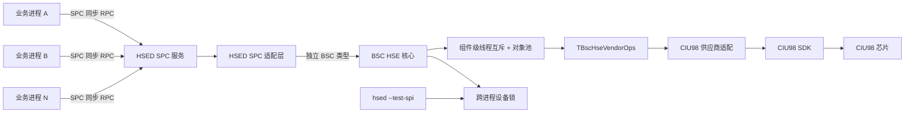
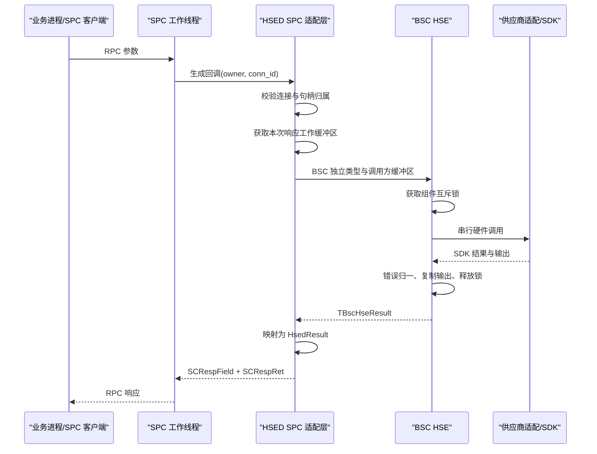
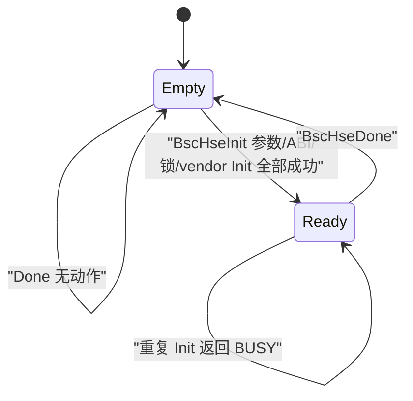

# 技术规范：0004 HSED BSC HSE 硬件密码能力组件化

## 基本信息

| 字段 | 内容 |
|---|---|
| 规范编号 | 0004 |
| 所属模块 | HSED 内部能力组件 |
| 关联功能 | 0004 BSC HSE 硬件密码能力组件化 |
| 创建日期 | 2026-07-21 |
| 更新日期 | 2026-07-27 |
| 状态 | 已批准；已补充当前代码逆向基线 |

## 概述

本规范定义 `framework/bsc_hse` 的公共接口、内部对象模型、供应商 SDK 隔离、线程与进程安全、CMake 依赖边界以及验证入口。当前分层为：HSED SPC 服务只依赖 BSC HSE 公共头文件；BSC HSE 核心只依赖注入的供应商操作表；RTE 在 Linux 平台加载供应商动态库；每个 `vendor/<芯片>` 动态库独占自身 SDK 依赖。

BSC HSE 是进程内单设备组件。多个业务进程通过 SPC 连接同一个 HSED 服务，SPC 的多个工作线程可以并发调用 BSC HSE；BSC HSE 必须保证全部公共函数线程安全，并把同一硬件加密设备的实际 SDK 调用严格串行化。跨进程排他锁是已批准但当前代码尚未完成的目标，不能据本文历史描述误判为已经实现。

> 生效规则：本文早期正文保留原始批准设计和反馈决策历史；发生冲突时，以
> `az-sdd/ARCH.md`、本文“2026-07-27 当前代码逆向基线”和最新已批准功能规范为
> 实现依据。特别是 pthread、编译期静态 vendor、BSC 内动态加载、独立
> `BscHseRuntimeInit/Done` 等旧描述均不得直接复制到新实现。

## 关联功能与验收来源

| 来源 | 内容 |
|---|---|
| 功能规范 | `az-sdd/spec/0004-hsed-BSC-HSE硬件密码能力组件化.spec.md` |
| 子功能规范 | `0005` 加密芯片管理、`0006` 数据加密、`0007` 数据解密、`0008` 数据签名、`0009` 密钥管理 |
| 功能目标 | 以独立组件承载 11 项 HSED 能力并隔离供应商 SDK |
| 验收标准 | 0004 的 [001] 至 [012] 以及 0005～0009 各自验收标准；本规范补充实现结构、接口和验证条件，不改变验收口径 |
| 权威接口模型 | `doc/hsed.xlsx` 的 `DataType`、`SPC-Params` 和 `SPC-Interface` |

## 技术复杂度评估

| 要素 | 评估 |
|---|---|
| 模块数量 | 5：SPC 生成层、SPC 适配层、BSC HSE 核心、供应商适配、CIU98 SDK/硬件 |
| 外部依赖 | SPC、OFC/SFC/ALOG、pthread、供应商 SDK、Linux SPI 设备 |
| 软硬件约束 | YLB04_A6；AG35 CETDA Linux；CIU98；C/CMake；禁止动态内存 |
| 并发约束 | 多进程 SPC 客户端、多 SPC 工作线程、单个有状态硬件 SDK |
| 主要风险 | 生成代码覆盖、SDK 能力差异、错误码漂移、句柄串用、输出缓冲区生命周期、死锁 |
| 结论 | 必须使用独立功能级技术规范，并在编码前人工审核 |

## 技术选型

### 选型对比

| 议题 | 选项 A | 选项 B | 最终选择 |
|---|---|---|---|
| 公共数据类型 | 直接包含生成的 `hsed_datatype.h` | BSC 定义独立稳定类型，由 SPC 映射 | 选择 B，隔离生成代码 |
| 供应商与物料选择 | 所有适配一起编译并用运行时分支选择 | CMake 每个目标只编译一个供应商适配和一个物料配置 | 选择后者，消除未选 SDK 依赖并避免错误复用槽位 |
| SDK 抽象 | 核心代码中散布供应商条件宏 | 内部 `TBscHseVendorOps` 操作表 | 选择操作表，便于 fake 验证 |
| 线程安全 | 由各 SPC 回调自行加锁 | BSC 公共 API 自身保证线程安全 | 选择组件内保证 |
| 硬件并发 | 按对象分别加锁 | 组件级非递归互斥，全部硬件访问串行 | 选择组件级互斥 |
| 跨进程访问 | 只依赖服务部署约定 | BSC 初始化取得统一 `flock` 排他锁 | 选择显式排他锁 |
| 对象内存 | `malloc/free` | 固定对象池和代际句柄 | 选择固定池，符合项目规则 |
| 输出数据 | BSC 返回内部临时指针 | 调用方提供缓冲区及容量 | 选择调用方缓冲区，避免并发覆盖 |

### 最终决策

| 层级 | 技术 | 选择理由 |
|---|---|---|
| 语言与 ABI | C ABI、现有 OFC 基础类型 | 与 HSED、SPC 生成代码和目标平台一致 |
| 构建系统 | CMake 静态库目标 `bsc_hse` | 明确 PUBLIC/PRIVATE 依赖，供应商实现不泄漏到 HSED |
| 线程互斥 | 进程内非递归 `pthread_mutex_t` | Linux/主机测试均可用，不新增第三方库；通过内部 Locked 函数避免递归加锁 |
| 跨进程互斥 | `/tmp/hsed-ciu98.lock` + 非阻塞 `flock` | 与 0003 自检共用设备所有权规则，防止多个进程访问同一芯片 |
| 对象管理 | 固定槽位对象池 + 64 位代际句柄 | 无动态内存；可识别销毁后复用的旧句柄 |
| SDK 适配 | 内部供应商操作表 + 编译期单适配选择 | BSC 核心可用 fake 测试，生产目标只携带一个 SDK |
| 物料配置 | 供应商适配内的独立物料配置 | 默认槽位、能力和限制随物料选择；CIU98 的 14 项槽位不得成为公共默认值 |
| 错误处理 | `TBscHseResult` 稳定错误枚举 | 供应商错误集中映射，SPC 不感知供应商错误码 |
| 日志 | ALOG；敏感数据禁止输出 | 沿用工程基础设施，降低密钥和业务数据泄漏风险 |

### 许可证检查

| 检查项 | 结果 |
|---|---|
| 新增开源依赖 | 无 |
| pthread/flock | Linux 系统能力，无新增分发依赖 |
| OFC/SFC/ALOG/SPC | 项目既有内部依赖 |
| CIU98 SDK | 仓库内既有供应商 SDK，继续按项目现有供应商许可使用 |
| 替代方案 | 未来供应商 SDK 通过相同内部适配契约接入，不改变公共 ABI |

## 架构设计

### 依赖架构



### 目录与文件边界

```text
framework/bsc_hse/
├── CMakeLists.txt
├── common/
│   ├── bsc_hse.c
│   ├── bsc_hse_internal.h
│   └── include/bsc_hse/
│       ├── bsc_hse.h
│       ├── bsc_hse_types.h
│       └── bsc_hse_vendor.h
└── test/
    ├── CMakeLists.txt
    ├── bsc_hse_test.c
    └── fake/bsc_hse_fake_vendor.c

vendor/
├── CMakeLists.txt
└── ciu98/
    ├── CMakeLists.txt
    ├── bsc_hse_ciu98.c
    └── sdk/
```

现有 `framework/bsc_hse/common/bsc_hse.c` 和 `common/include/bsc_hse/bsc_hse.h` 是用户已创建的骨架，编码阶段在原文件上补充，不删除或另建重复公共入口。

### 模块划分

| 模块 | 职责 | 禁止事项 |
|---|---|---|
| SPC 生成层 | 保持 `doc/hsed.xlsx` 生成的 11 项 RPC 定义 | 不包含供应商 SDK 头文件，不实现硬件算法 |
| SPC 适配层 | 解码 SPC 参数、校验连接归属、管理响应缓冲区、调用 BSC、映射返回值 | 不直接调用 SDK；不把 `conn_id` 当作硬件 `key_id` |
| BSC HSE 核心 | 公共 API、初始化状态、对象池、属性状态、参数组合校验、线程互斥、错误归一 | 不包含任何供应商头文件或供应商类型 |
| 供应商抽象 | 定义核心所需的最小硬件操作集合 | 不向公共头文件暴露 |
| CIU98 适配 | 将 BSC 请求转换为 CIU98 `keyinfo_t`、算法参数及 SDK 调用；集中映射错误 | 不改变 BSC/SPC 业务语义，不伪造不支持能力 |
| 物料配置 | 定义当前物料的物理槽位映射、支持能力和限制 | 不把某一物料的槽位编号写入 BSC 公共头文件或跨物料复用 |
| fake 适配 | 主机测试中模拟成功、失败、延时、并发探针和输出 | 不进入生产目标 |

## 公共 API 设计

### 公共类型原则

1. `bsc_hse.h` 和 `bsc_hse_types.h` 不包含 `hsed_datatype.h`、SpanCall 头文件或任何供应商 SDK 头文件。
2. `TBscHseResult`、`TBscHseAlgorithm`、`TBscHsePropertyId`、密码模式、补位、签名输入模式和 SM9 模式采用 BSC 前缀。
3. 枚举数值与 `doc/hsed.xlsx` 当前模型保持一致，以便明确映射；SPC 适配编译单元对每个结果码、算法和属性 ID 使用静态断言或显式 `switch` 映射，禁止未经检查的跨枚举强制转换。
4. `TBscHseHandle` 为 `UInt64`。低位保存对象槽位加一，高位保存非零代际值；销毁后旧句柄必须返回 `OBJECT_NOT_FOUND`。
5. 所有数组接口使用“调用方缓冲区 + 容量/实际长度指针”。传入时长度表示容量，成功返回时更新为实际长度；容量不足返回 `DATA_TOO_LARGE` 并报告所需长度，禁止部分成功。

### 生命周期与 11 项功能接口

公共接口按以下 C 语义设计；编码时遵循项目文件头、命名、单一 `return` 和无动态内存规则。

```c
TBscHseResult BscHseInit(const TBscHseConfig *config);
void BscHseDone(void);

TBscHseResult BscHseCreate(TBscHseHandle *handle);
TBscHseResult BscHseDestroy(TBscHseHandle handle);

TBscHseResult BscHseSetPropertyInt(TBscHseHandle handle,
                                    TBscHsePropertyId property_id,
                                    Int32 value);
TBscHseResult BscHseSetPropertyBytes(TBscHseHandle handle,
                                      TBscHsePropertyId property_id,
                                      const UInt8 *value,
                                      UInt32 value_size);
TBscHseResult BscHseGetPropertyInt(TBscHseHandle handle,
                                    TBscHsePropertyId property_id,
                                    Int32 *value);
TBscHseResult BscHseGetPropertyBytes(TBscHseHandle handle,
                                      TBscHsePropertyId property_id,
                                      UInt8 *value,
                                      UInt32 *value_size);

TBscHseResult BscHseEncrypt(TBscHseHandle handle,
                             TBscHseAlgorithm algorithm,
                             const UInt8 *input_data,
                             UInt32 input_size,
                             UInt8 *output_data,
                             UInt32 *output_size);
TBscHseResult BscHseDecrypt(TBscHseHandle handle,
                             TBscHseAlgorithm algorithm,
                             const UInt8 *input_data,
                             UInt32 input_size,
                             UInt8 *output_data,
                             UInt32 *output_size);
TBscHseResult BscHseSign(TBscHseHandle handle,
                          TBscHseAlgorithm algorithm,
                          const UInt8 *input_data,
                          UInt32 input_size,
                          UInt8 *signature,
                          UInt32 *signature_size,
                          UInt32 *r_size,
                          UInt32 *s_size);
TBscHseResult BscHseExportPublicKey(TBscHseHandle handle,
                                     TBscHseAlgorithm algorithm,
                                     UInt8 *public_key,
                                     UInt32 *public_key_size);
TBscHseResult BscHseImportPublicKey(TBscHseHandle handle,
                                     TBscHseAlgorithm algorithm,
                                     const UInt8 *public_key,
                                     UInt32 public_key_size,
                                     Bool replace_existing_key);
```

`BscHseSign` 超过五个参数是对既有 SPC 契约的必要映射；不得为减少参数而改变签名结果、`r_size` 或 `s_size` 语义。

`BscHseSign` 的公共注释和实现前置检查必须明确：SM2 签名要求对象已保存至少 16 字节 `USER_ID`；不足 16 字节返回 `INVALID_PARAM`；超过 16 字节时只把前 16 字节传给 ZA 派生和供应商适配，后续字节不得参与本次签名。

### 初始化配置

`TBscHseConfig` 至少包含：

| 字段 | 用途 |
|---|---|
| 设备路径 | 供应商适配初始化前选择 SPI 设备；当前默认 `/dev/spidev1.0` |
| 设备锁路径 | 默认 `/tmp/hsed-ciu98.lock`；正常服务与 0003 自检必须一致 |
| 物料配置选择 | 指向构建时选定的供应商物料配置；公共配置不携带 CIU98 专用槽位常量 |
| 操作超时 | 由适配转换为供应商可支持的超时或轮询限制 |

现有模型定义的是逻辑密钥属性角色，没有给出具体硬件槽位编号。CIU98 使用的 4 个对称槽位和 5 组非对称公私钥槽位（共 14 项）是 CIU98 物料的独立规定，必须放在对应 CIU98 物料配置中，不得上升为 BSC 跨供应商默认值。发生物料切换时必须重新定义并审核该物料的槽位映射、能力和限制；禁止复制或回退到 CIU98 的 14 项配置。当前物料配置缺失、重复冲突、角色非法或与芯片能力不匹配时 `BscHseInit` 返回 `INVALID_PARAM` 或 `UNSUPPORTED`，不得连接芯片、猜测槽位、自动占用槽位或用属性 ID 代替槽位编号。

### 对象与属性模型

1. BSC 核心维护固定大小 `TBscHseObject` 池；池容量由编译配置明确，默认与 HSED 最大连接数 8 对齐。池耗尽时创建返回 `NO_RESOURCE`。
2. 每个对象保存 HSED 模型定义的逻辑密钥属性引用、可变整数属性、`USER_ID` 字节数据及实际长度、各对称算法 IV 及其有效长度；对象创建时由当前物料配置把逻辑密钥属性初始化为该物料的物理槽位。CIU98 当前物料提供 14 项映射，其他物料必须独立定义，不要求沿用相同物理槽位值；对象不得保存 SPC `conn_id`。
3. SPC 适配层维护“连接 → BSC 句柄”归属并在每次调用前校验。连接断开或孤儿响应清理时调用 `BscHseDestroy`。
4. `CHIP_ID` 是设备级一次写入属性，由供应商适配读写；它不复制到各对象。写入前必须确认硬件明确处于未配置状态，通信或读取异常时禁止尝试覆盖。
5. 整数属性和字节属性的合法组合、默认值、长度及算法关系严格依据 `doc/hsed.xlsx`；未知属性返回 `UNSUPPORTED`，类型不匹配返回 `INVALID_PARAM`。

## 供应商适配设计

### 内部操作表

`vendor/bsc_hse_vendor.h` 定义私有 `TBscHseVendorOps`，至少包含：

- `Init`、`Done`；
- 读取并校验当前物料能力和逻辑密钥属性到物理槽位的映射；
- 查询/读写设备标识；
- 查询槽位存在性、算法和公私钥角色；
- 仅在明确不存在时生成允许自动生成的 RSA1024、RSA2048、ECC256、SM2 默认密钥对；
- 对称/非对称加密和解密；
- 非对称签名；
- 公钥导入和导出。

操作表参数全部使用 BSC 私有中间结构，不使用 CIU98 类型。CIU98 适配在一个编译单元内完成 `TBscHseAlgorithm` 到 SDK 算法、模式、补位、哈希、`keyinfo_t` 和公钥格式的转换。

### CIU98 错误映射

| SDK 失败类别 | BSC 结果 |
|---|---|
| 参数、长度或组合非法 | `INVALID_PARAM` 或 `DATA_TOO_LARGE` |
| SDK/芯片不支持算法或模式 | `UNSUPPORTED` |
| 认证或权限失败 | `PERMISSION_DENIED`；明确锁定时 `AUTH_LOCKED` |
| 槽位不存在 | `KEY_NOT_FOUND` |
| 槽位已存在且禁止覆盖 | `KEY_OCCUPIED` |
| 设备或槽位忙 | `BUSY` |
| 通信超时 | `TIMEOUT` |
| 设备未连接、初始化失败 | `DEVICE_UNAVAILABLE` |
| 其他已连接设备错误 | `DEVICE_ERROR` |

未知 SDK 错误必须记录阶段和原始错误码后返回 `DEVICE_ERROR`；日志不得记录密钥、私钥、公钥导入原文、业务明密文、完整签名输入或认证数据。

### 能力差异

- 适配必须为每个算法/操作提供明确能力判断；缺失能力返回 `UNSUPPORTED`，不得软件回退或替换算法。
- 私钥导入/导出、验签、摘要、随机数、密钥删除和固件升级不进入公共操作表。
- CIU98 SDK 虽提供部分范围外函数，生产适配不得通过 BSC 公共 API 暴露。
- 对称密钥和 SM9 默认密钥不得自动生成；仅由授权业务通过另行批准的密钥注入流程预置。
- CIU98 的 14 项默认槽位仅对选定 CIU98 物料有效；任何物料切换必须选择新的物料配置并重新执行槽位角色、存在性和覆盖保护测试。

## 多线程与多进程安全

### 线程安全契约

1. `BscHseInit`、`BscHseDone` 和全部 11 项功能函数均为线程安全公共入口。
2. 组件维护一把非递归全局互斥锁，保护初始化状态、对象池、对象属性、供应商操作表和所有 SDK 调用。首版以正确性优先，属性读写也纳入同一互斥域。
3. 每个公共函数只加锁一次；需要复用的逻辑实现为带 `Locked` 后缀的私有函数，私有函数不得再次加锁，避免递归死锁。
4. 参数的空指针、明显长度检查可在加锁前完成；句柄、对象状态、属性和供应商能力检查必须在锁内完成。输出长度和数据必须在解锁前写入调用方缓冲区。
5. 任何锁内路径都必须汇聚到统一清理段并释放互斥锁；禁止在持锁期间调用用户回调或 SPC API。
6. `BscHseDone` 获取同一互斥锁，因此会等待当前同步操作完成；取得锁后切换为停止状态、清理对象、断开 SDK、释放跨进程锁。停止后新调用返回 `DEVICE_UNAVAILABLE`。
7. 供应商 SDK 即使声明内部线程安全，也不得移除 BSC 串行化；设备协议、选择状态和安全会话按单一有状态资源处理。

### 多进程安全契约

1. 多个业务进程不得直接链接供应商 SDK 并打开同一 SPI；统一通过 SPC 调用单个 HSED 服务。
2. `BscHseInit` 在任何 SDK 注册、复位或连接前，以非阻塞方式取得 `/tmp/hsed-ciu98.lock`。失败返回 `BUSY`，不得访问硬件。
3. 正常 HSED 与 `hsed --test-spi` 使用相同锁文件和相同所有权规则；进程异常退出后由内核释放文件锁。
4. `flock` 只解决设备进程所有权，不能替代 SPC 连接归属校验或 BSC 线程互斥。

### 并发验证条件

- fake 适配维护原子 `active_calls` 和 `max_active_calls`；多线程压力测试结束后必须满足 `max_active_calls == 1`。
- 至少 8 个线程并发执行创建、属性读写、加解密、签名和销毁循环；不得出现死锁、崩溃、错误响应归属或对象状态污染。
- 同一句柄并发执行属性修改与密码运算时，只允许完整的调用前状态或调用后状态，不允许读取部分更新状态。
- 销毁与运算并发时，先获得锁者完成；后获得锁者只能得到完整成功或 `OBJECT_NOT_FOUND`，不得访问已释放槽位。
- 两个进程同时初始化时只允许一个成功，另一个返回 `BUSY` 且 fake/设备探针确认未进入 SDK 初始化。

## SPC 适配与数据流

### 调用流程



### 生成代码保护

1. `doc/hsed.xlsx` 和 `doc/spc-build.bat` 继续是接口模型与生成入口。
2. 生成的 `hsed_srv.c` 只在预留 TODO 回调区调用稳定的 SPC 适配函数；具体业务实现不得写入生成文件。
3. SPC 适配函数放在非生成源文件中，接收 `owner/conn_id` 与解码后的参数，完成连接归属、BSC 调用和结果映射。
4. 每次重新生成后运行静态检查，确认 11 个 `L_Exec_*` 回调仍全部委托给 SPC 适配；缺少任意委托时构建失败或验证失败，防止生成覆盖造成空实现。

### 响应缓冲区

SPC 适配层维护固定数量的工作缓冲区，数量至少覆盖配置的响应线程数，单块容量不得超过 SPC 与 BSC 共同允许的最大消息长度。缓冲区从解码开始租用，直至 `SCRespFieldByStr` 完成复制后释放；池耗尽返回 `NO_RESOURCE`。禁止：

- 使用 BSC 全局临时输出缓冲区；
- 解锁后继续引用供应商 SDK 内部指针；
- 在栈上无边界分配大数组；
- 截断后返回成功。

## 构建与部署架构

### CMake 目标边界

1. `framework/bsc_hse/CMakeLists.txt` 创建静态库 `bsc_hse`。
2. `common/include` 是 `PUBLIC` include；内部头文件、供应商头文件和 SDK 源码目录全部为 `PRIVATE`。
3. HSED 的 `build/common/CMakeLists.txt` 使用独立二进制目录加入 BSC 子目录，并通过 `target_link_libraries(hsed PRIVATE bsc_hse ...)` 依赖组件。
4. 当前直接列入 HSED 的 CIU98 include、源文件 glob 和 demo/test 源码全部移出 HSED 目标；CIU98 生产适配只编译 SDK 必需源文件，禁止编译 `examples/user/all_api_test.c` 或 demo 测试源码。
5. CMake 缓存变量 `BSC_HSE_VENDOR` 明确选择供应商适配，当前 YLB04_A6 使用 `ciu98`；未知值必须在配置阶段 `FATAL_ERROR`，不得静默回退。
6. CMake 缓存变量 `BSC_HSE_MATERIAL` 明确选择该供应商下的具体物料配置。未设置、未知或与 `BSC_HSE_VENDOR` 不匹配时配置阶段必须失败；不得提供跨物料的 CIU98 默认槽位回退。
7. `BUILD_PLATFORM_NAME=ag35_cetda` 决定平台端口实现；平台、供应商 SDK 和物料配置三者分离，方便同一平台适配不同运营商 SDK或不同物料。
8. fake 适配只在 `BSC_HSE_BUILD_TESTS=ON` 的测试目标编译，生产构建禁止链接 fake。

### 部署与生命周期

| 阶段 | 行为 |
|---|---|
| HSED 启动 | 初始化日志和基础设施；加载构建时选定的供应商与物料配置；调用 `BscHseInit` 校验能力和槽位；成功后才开放 SPC 服务 |
| 运行 | SPC 多线程调用 BSC；BSC 内部串行访问 CIU98 |
| HSED 关闭 | 先停止接受新 SPC 请求并等待在途请求结束，再调用 `BscHseDone`，最后退出基础设施 |
| 初始化失败 | 不开放可处理密码请求的 SPC 服务；记录阶段和统一错误后退出或进入明确不可用状态 |
| 自检 | 复用相同跨进程锁；不得与正常服务同时访问设备 |

## 运行与验证条件

| 项目 | 内容 |
|---|---|
| Windows 交叉构建入口 | `C:\HQ_Workspace\YLB04_A6\code\task-jpz_dev\mpu\az_build_linux_hsed.bat` |
| Linux 容器构建入口 | `C:\HQ_Workspace\YLB04_A6\code\task-jpz_dev\mpu\az_build_linux_app_hsed.sh` |
| 主机自动验证 | 以 `BSC_HSE_VENDOR=fake`、`BSC_HSE_BUILD_TESTS=ON` 构建独立测试目标并运行 CTest |
| 静态依赖验证 | 扫描 HSED/SPC 层不得包含 CIU98 SDK 头文件或引用 `api_*`；未选适配不得进入编译命令或链接依赖 |
| 契约验证 | 比较 BSC 枚举与 `hsed_datatype.h` 数值；检查 11 个生成回调全部委托 SPC 适配 |
| 线程验证 | 运行并发压力、同句柄竞争、销毁竞争和 fake 最大并发探针测试 |
| 进程验证 | 同时启动两个实例或自检与正常服务，确认只有一个取得设备锁 |
| 设备人工验收 | AG35 CETDA、选定供应商 SDK、明确的物料标识、该物料独立定义并审核的槽位配置及授权测试密钥；CIU98 当前物料应验证其 14 项映射；按 0004 spec 的 MT001 至 MT008 执行 |

### 自动测试最小集合

| 测试 | 覆盖内容 |
|---|---|
| `bsc_hse_lifecycle_test` | 初始化、重复初始化、关闭、未初始化调用、设备锁失败 |
| `bsc_hse_object_test` | 对象池耗尽、代际句柄、销毁后访问、属性默认值与长度 |
| `bsc_hse_crypto_test` | 11 项能力成功路径、输入/输出容量、算法与槽位角色 |
| `bsc_hse_error_map_test` | 所有 `TBscHseResult` 及未知 SDK 错误映射 |
| `bsc_hse_thread_test` | 多线程压力、最大 SDK 并发为 1、销毁竞争、无死锁 |
| `bsc_hse_vendor_select_test` | fake/CIU98 单适配选择和未选 SDK 零依赖 |
| `bsc_hse_material_test` | 物料配置缺失/不匹配、槽位冲突、CIU98 14 项映射及切换物料后禁止沿用旧映射 |
| `hsed_spc_contract_test` | 11 个 RPC、连接归属、BSC/HSED 类型映射和响应缓冲区 |

## 风险与决策

| 风险/决策 | 影响 | 处理方式 |
|---|---|---|
| 全局互斥降低吞吐量 | 所有请求串行等待 | 硬件和 SDK 本身是单一有状态资源；首版优先正确性，记录锁等待/执行耗时用于后续评估 |
| 非递归锁被内部重复获取 | 死锁 | 公共函数唯一加锁，内部复用函数统一使用 `Locked` 后缀并在代码评审检查 |
| SPC 多进程被误解为 SDK 多进程直连 | 设备状态冲突 | 强制所有业务进程经 SPC；BSC 初始化使用跨进程排他锁 |
| 生成代码重新生成后委托丢失 | 11 项接口退化为空实现 | 委托逻辑最小化并加入生成后静态检查 |
| BSC 与 HSED 枚举数值漂移 | 错误算法或属性被调用 | 独立类型 + 静态断言/显式映射；模型变化必须触发编译或测试失败 |
| 固定对象/缓冲池容量不足 | 高并发返回 `NO_RESOURCE` | 容量显式配置并与 SPC 线程、连接数核对；禁止运行时动态扩容 |
| SDK 调用长期阻塞 | 所有后续请求排队 | 配置操作超时；记录锁等待和 SDK 执行耗时；不可取消的 SDK 调用需在供应商适配风险清单中标注 |
| 将 CIU98 的 14 项槽位误当成公共默认值 | 切换物料后访问或覆盖错误密钥 | 槽位表归属具体物料配置；供应商和物料必须显式匹配，物料切换后重新定义、审核并测试，禁止默认回退 |
| CIU98 不支持模型声明的部分组合 | 验收失败或行为不一致 | 能力表明确返回 `UNSUPPORTED`；禁止软件回退或伪成功，并在设备验收前形成支持矩阵 |
| 敏感数据进入日志 | 密钥或业务数据泄漏 | 只记录算法、槽位、长度、阶段、统一结果和 SDK 错误码；禁止记录数据内容 |

## 实施顺序约束

1. 先建立独立 BSC 类型、公共 API、固定对象池、线程/进程锁和 fake 适配测试。
2. 再实现 CIU98 供应商操作表、当前 CIU98 物料的 14 项槽位配置和错误映射，形成“供应商 + 物料”能力支持矩阵。
3. 调整 CMake 目标边界，确保 HSED 只看到 BSC 公共头文件且未选 SDK 零依赖。
4. 实现 SPC 适配、连接归属和固定响应缓冲池，再将 11 个生成回调委托到适配层。
5. 依次执行主机测试、交叉构建、设备单请求验证、线程并发验证和多进程设备锁验证。

## 备注

- 本规范不新增或删除 SPC 功能；功能范围和验收口径以 0004 spec 为准。
- `session_id`/连接归属是 SPC 层职责；BSC 线程安全只保证进程内共享组件状态和硬件调用安全，不能替代权限校验。
- 当前 `framework/bsc_hse` 骨架文件由用户在 2026-07-20 创建，编码阶段必须保留其历史并在原位置完善。
- 原规范已于 2026-07-21 获批；FB-2026-001 修订于 2026-07-24 进入审核，在修订获批前暂停新的 `/az-sdd-coder 0004` 执行。

## FB-2026-001 架构修订（已批准）

> 本节修订 BSC HSE、RTE 和 app 的依赖边界。与本节冲突的既有“BSC 直接加载动态库、持有动态库句柄、按 `.so` 路径选择供应商实现、在 BSC 构建目标中选择/编译供应商 SDK”的条款停止执行；待本次修订批准后，以本节为准。

### 修订状态

| 字段 | 内容 |
|---|---|
| 关联反馈 | FB-2026-001 |
| 修订日期 | 2026-07-24 |
| 状态 | 已批准 |
| 影响范围 | 0004～0009 |

### 分层边界

| 层级 | 职责 | 禁止事项 |
|---|---|---|
| `framework/bsc_hse` | 定义公共类型/API、供应商能力虚接口；完成对象管理、参数校验、属性状态、串行调用和统一错误语义 | 不包含 `dlfcn.h`、`dlopen/dlsym/dlclose`、`.so` 路径、动态库句柄、Linux 专用加载逻辑；不直接包含 CIU98 SDK |
| `rte_component/rte_hse` | 根据项目平台加载供应商动态库；校验导出符号和接口版本；把导出的操作表注入 BSC；管理动态库及供应商运行时生命周期 | 不实现具体芯片 SDK 适配、BSC 对象语义和 SPC 会话语义 |
| `vendor/<芯片>` | 每款加密芯片使用独立子目录和独立 `CMakeLists.txt`，封装自身 SDK 并生成供应商动态库 | 不包含 RTE 动态加载逻辑，不依赖 BSC 私有实现 |
| app/SPC 适配层 | 读取项目配置；初始化 RTE 并取得 BSC 虚接口；注入并初始化 BSC；把 11 项 SPC 回调映射到 BSC；按逆序关闭 | 不直接调用 CIU98 SDK 完成 SPC 密码业务；不把平台加载逻辑回写 BSC |

### 依赖方向

```text
SPC client
    -> generated SPC server callback
    -> app/SPC adapter
    -> BSC HSE public API
    -> injected BSC HSE vendor interface
    -> RTE HSE implementation
    -> CIU98 dynamic library / hardware
```

编译期依赖保持单向：app 依赖 BSC 公共接口和 RTE 接口；RTE 依赖 BSC 虚接口类型及项目平台能力；`vendor/<芯片>` 只依赖 BSC 公共虚接口契约和自身 SDK；BSC 不依赖 RTE、app、Linux 动态加载 API 或具体芯片 SDK。

### BSC 虚接口注入契约

1. BSC HSE 使用 C 操作表作为虚接口，不要求 C++ RTTI 或虚函数运行时。
2. RTE 在 `BscHseInit` 前通过显式注册 API 注入完整、只读、生命周期稳定的操作表及实现上下文。
3. 注册 API 校验接口版本、结构体大小和必需操作是否完整；校验失败不得改变当前注册状态。
4. BSC 只保存操作表和不透明上下文，不保存动态库句柄，不负责符号解析和卸载。
5. 未注入接口时，`BscHseInit` 返回统一的 `DEVICE_UNAVAILABLE` 或对应初始化失败结果。
6. 运行期间不得替换已注入接口；关闭 BSC 后才允许解除注册或重新注入。
7. fake 测试实现与 RTE 生产实现使用同一注入契约。

### RTE 动态库契约

1. `.so` 路径、供应商类型、物料配置和平台参数由 app 配置传入 RTE，不进入 BSC 公共 API。
2. RTE 负责 `dlopen/dlsym/dlclose`、导出符号校验、接口版本校验、错误日志和资源回滚。
3. `vendor/ciu98` 将 CIU98 专用返回码、参数结构和生命周期封装在动态库内部；RTE 只加载并校验统一虚接口。
4. 加载失败、缺少必需符号、版本不匹配或供应商初始化失败时，RTE 返回明确失败，app 不得启动可处理密码请求的 SPC 服务。
5. 关闭顺序为：停止接收 SPC 请求并等待在途请求结束 -> `BscHseDone` -> RTE 供应商关闭 -> `dlclose`。

### 构建边界修订

1. `framework/bsc_hse` 仅构建平台无关 BSC 源码；其生产目标不链接 `dl`，不编译 CIU98 SDK 和 `rte_hse`。
2. `rte_component/CMakeLists.txt` 构建项目 RTE 目标；Linux 项目可在该目标链接 `dl`，但不得编译具体芯片 SDK。
3. `vendor/<芯片>/CMakeLists.txt` 分别生成对应芯片动态库；当前 `vendor/ciu98` 生成 `libciu98_hse.so`。
4. app 最终目标同时链接 BSC 和 RTE；供应商动态库作为独立产物构建，不改变 BSC。
5. BSC fake 测试直接注入 fake 操作表，可在不支持 Linux 动态库的主机环境运行。

### app 初始化与 SPC 衔接

```text
读取 app 配置
  -> RteHseLoad/Init
  -> 获取 BSC 虚接口
  -> BscHseVendorRegister
  -> BscHseInit
  -> 启动 SPC 服务
  -> SPC 回调经 app 适配调用 BSC
```

任何前置步骤失败时均不得开放 SPC 密码服务。退出时严格执行逆序清理。

### 修订验证条件

| 验证项 | 通过条件 |
|---|---|
| BSC 平台无关性静态检查 | `framework/bsc_hse` 不出现 `dlfcn.h`、`dlopen`、`dlsym`、`dlclose`、`RTLD_*` 或动态库路径配置 |
| BSC 构建边界 | BSC 目标不链接 `dl`，不编译 CIU98 SDK/RTE 源码 |
| 虚接口契约 | 缺失注入、接口版本错误、结构体大小错误、缺少必需操作均稳定失败；有效 fake 注入后原有组件测试通过 |
| RTE 加载 | 动态库不存在、符号缺失、版本不匹配、初始化失败均正确回滚，不泄漏句柄 |
| app/SPC 集成 | app 完成 RTE -> BSC -> SPC 的初始化顺序；11 项 SPC 能力仍经 BSC 调用 |
| 交叉构建 | HSED 项目目标在 AG35 CETDA 构建环境成功构建 |

### 实施顺序

1. 收敛 BSC 虚接口注册 API，删除 BSC 内所有动态库加载、测试加载和句柄管理代码。
2. 调整 fake 测试为直接注入，验证 BSC 在无 `dl` 依赖下通过现有回归。
3. 在 `rte_component/rte_hse` 实现 Linux 动态库加载和资源回滚，在 `vendor/ciu98` 独立封装 CIU98 SDK。
4. app 初始化 RTE/BSC，并将生成的 SPC 回调衔接到 BSC。
5. 更新 CMake 目标边界，执行静态检查、组件回归、RTE 异常测试、SPC 契约测试和交叉构建。

## FB-2026-003 架构修订（已批准）

> 本节落实“操作系统相关接口优先使用 SFC 组件接口”的公司规范。与本节冲突的
> 既有 `pthread_mutex_t` 技术选型、生命周期和验证条款，在本修订批准后以本节
> 为准；未批准前不得直接进行锁类型替换。

### 修订状态

| 字段 | 内容 |
|---|---|
| 关联反馈 | FB-2026-003 |
| 修订日期 | 2026-07-24 |
| 状态 | 已批准 |
| 影响范围 | 0004～0009；BSC、RTE、app 与相关测试 |

### 公司 OS 接口使用原则

1. 公司自有业务层、组件层和框架层存在 SFC 等价能力时，必须优先使用 SFC，
   不得直接调用 pthread 或其他 OS 接口实现同类能力。
2. BSC 进程内组件互斥采用 `TSfCriticalSection`；禁止继续包含 `pthread.h`、
   使用 `pthread_mutex_t`、`PTHREAD_MUTEX_INITIALIZER` 或 `pthread_mutex_*`。
3. SFC 未提供等价能力时，直接 OS 接口只能位于明确边界：
   - `signal` 仅位于 app 进程入口，用于接收 Linux 退出信号；
   - `dlopen/dlsym/dlclose` 仅位于 `rte_component/rte_hse` Linux 适配；
   - `open/ioctl/mmap` 等供应商 SDK 系统调用仅位于 `vendor/<芯片>/.../port/<平台>`。
4. 每项例外必须能说明 SFC 能力缺口、所属平台边界和验证方法；不得把例外扩散到
   BSC 核心、SPC 业务适配或普通 app 组件。
5. 新增公司自有代码时，评审和静态扫描同时检查 SFC 可替代性与例外归属。

### BSC runtime 生命周期

`TSfCriticalSection` 没有静态初始化器，必须先构造后使用。当前
`BscHseVendorRegister` 在 `BscHseInit` 前执行且已经需要互斥，因此增加独立的
BSC runtime 基础设施生命周期：

```c
Int32 BscHseRuntimeInit(void);
Int32 BscHseRuntimeDone(void);
```

1. `BscHseRuntimeInit` 只创建全局 `TSfCriticalSection`、清零 BSC runtime 状态，
   不加载动态库、不注册 vendor、不连接硬件。
2. `BscHseRuntimeDone` 只允许在 `BscHseDone` 已完成且 vendor 已解除注册后执行；
   它通过 `OfDestroyObject((TOfObject *)&lock)` 销毁临界区并清零构造标志。
3. runtime 引导与销毁由 app 主线程串行执行，不作为并发业务 API；从 vendor 注册
   开始到 BSC 功能 API 结束的全部状态访问由已构造的临界区保护。
4. runtime 未创建时，vendor 注册、BSC 初始化及功能 API 必须稳定失败，且不得进入
   `TSfCriticalSectionEnter`。
5. 重复初始化、仍有 vendor 注册时销毁、BSC 仍在运行时销毁均返回明确错误，不得
   部分清理或销毁仍在使用的临界区。

### RTE 与 app 顺序修订

正常服务初始化顺序固定为：

```text
app 基础设施初始化
  -> BscHseRuntimeInit
  -> RTE 加载动态库
  -> BscHseVendorRegister
  -> BscHseInit
  -> 开放 SPC 服务
```

退出顺序固定为：

```text
停止 SPC 并等待在途请求
  -> BscHseDone
  -> BscHseVendorUnregister
  -> RTE 卸载动态库
  -> BscHseRuntimeDone
  -> app 基础设施反初始化
```

1. `RteHseInit` 对 app 保持单一入口，在加载和注册前调用
   `BscHseRuntimeInit`；任一后续步骤失败时按逆序回滚。
2. `RteHseDone` 在解除 vendor 注册、卸载动态库后调用
   `BscHseRuntimeDone`；清理失败必须记录并保持可诊断状态，不得静默销毁在用资源。
3. app 仍保持 `RteHseInit -> BscHseInit` 的可见调用顺序；RTE 内部负责 runtime
   引导，避免 app 重复掌握 BSC 私有锁对象。
4. fake BSC 测试若绕过 RTE 直接注册 vendor，必须显式执行
   `BscHseRuntimeInit -> Register -> BscHseInit`，并按逆序清理。
5. `RteHseSelfTest` 当前直接调用供应商动态库自检且不注册 BSC；若自检不访问 BSC
   状态，则无需创建 BSC runtime。后续一旦复用 BSC 注册路径，必须遵守相同顺序。

### SFC 互斥实现约束

1. `TbscHseRuntime` 保存 `TSfCriticalSection lock` 和独立的
   `Bool runtime_initialized` 标志。
2. 构造成功后才设置 `runtime_initialized=True`；构造失败返回
   `NO_RESOURCE` 或项目统一的初始化失败结果。
3. 所有原 `pthread_mutex_lock/unlock` 路径分别替换为
   `TSfCriticalSectionEnter/Leave`，并检查进入失败结果，禁止假定必然成功。
4. 所有成功进入临界区的路径必须成对离开；功能逻辑继续使用既有 Locked 私有函数，
   不引入递归加锁。
5. `framework/bsc_hse` 构建目标显式依赖 SFC/OFC 头文件及实现；移除不再需要的
   pthread 直接依赖，但不得破坏 SFC 在目标平台内部所需的系统链接依赖。

### 修订验证条件

| 验证项 | 通过条件 |
|---|---|
| SFC 迁移静态检查 | `framework/bsc_hse` 中 `pthread.h`、`pthread_mutex_*`、`PTHREAD_MUTEX_INITIALIZER` 为 0；存在完整的 SFC 临界区构造、进入、离开和销毁 |
| runtime 状态机 | 未初始化、重复初始化、注册失败回滚、运行中销毁、正常逆序退出、重复退出均得到稳定结果且无未构造对象访问 |
| BSC 回归 | 现有对象、属性、密码运算、错误映射和线程压力测试全部通过，`max_active_calls == 1` |
| RTE 回归 | 动态库不存在、符号缺失、ABI 错误、注册失败和正常加载均正确回滚 runtime 与动态库句柄 |
| OS 接口边界 | `signal` 只在 app 入口；动态库接口只在 RTE Linux 实现；供应商系统调用只在平台端口；BSC/SPC 普通业务代码无可由 SFC 替代的直接 OS 接口 |
| 交叉构建 | HSED 及相关 BSC/RTE 目标在 AG35 CETDA 环境编译通过 |

### 实施顺序

1. 增加 runtime API 和状态机测试，先验证所有失败回滚路径。
2. 将 BSC 全局锁迁移为 `TSfCriticalSection`，保持 Locked 私有函数结构不变。
3. 调整 RTE 初始化/清理和 fake/RTE 测试生命周期。
4. 更新 CMake 的 SFC/OFC 依赖与 OS 接口静态扫描。
5. 执行 BSC 回归、RTE 加载器测试、AG35 交叉构建并回写反馈证据。

## 2026-07-27 当前代码逆向基线

本节只描述当前仓库可观察行为，不把未完成项降级为“无需实现”。完整项目级调用链、
构建和差异优先级见 `az-sdd/ARCH.md`。

### 当前公共接口

```c
Int32 BscHseInit(const TbscHseVendorBinding *binding,
                 TbscHseObject *object_pool,
                 UInt32 object_pool_count);
void BscHseDone(void);

Int32 BscHseCreate(TbscHseHandle *handle);
Int32 BscHseDestroy(TbscHseHandle handle);
Int32 BscHseSetPropertyInt(TbscHseHandle handle,
                           TbscHsePropertyId property_id,
                           Int32 value);
Int32 BscHseSetPropertyBytes(TbscHseHandle handle,
                             TbscHsePropertyId property_id,
                             const UInt8 *value,
                             UInt32 value_size);
Int32 BscHseGetPropertyInt(TbscHseHandle handle,
                           TbscHsePropertyId property_id,
                           Int32 *value);
Int32 BscHseGetPropertyBytes(TbscHseHandle handle,
                             TbscHsePropertyId property_id,
                             UInt8 *value,
                             UInt32 *value_size);
Int32 BscHseEncrypt(...);
Int32 BscHseDecrypt(...);
Int32 BscHseSign(...);
Int32 BscHseExportPublicKey(...);
Int32 BscHseImportPublicKey(...);
```

当前没有公开 `BscHseRuntimeInit/Done`、vendor register/unregister 或
`TBscHseConfig`。`BscHseInit` 本身完成 SFC 临界区创建、ABI 校验、binding 保存、
vendor `Init` 和对象池清零；失败时销毁锁并清零运行态。`BscHseDone` 在锁内调用
vendor `Done`、清空对象池，然后销毁锁和 binding。

### BSC 初始化状态机



未初始化时所有对象、属性和密码 API 返回 `DEVICE_UNAVAILABLE`；明显的空指针或
算法类型错误可在进入运行态前先返回 `INVALID_PARAM/UNSUPPORTED`。

### Binding 与 RTE

| 项目 | 当前值 |
|---|---|
| vendor ABI | 2 |
| binding | `ops + info + context`，由动态库静态对象提供 |
| 必需动态库符号 | `BscHseVendorSdkApi` |
| 自检符号 | `BscHseVendorTest` |
| RTE 加载 | `dlopen(path, RTLD_NOW | RTLD_LOCAL)` |
| ABI 检查 | BSC Init 检查版本、结构大小和 7 个函数指针 |
| RTE 关闭 | 只 `dlclose` 并清空 RTE 状态；调用方必须先 `BscHseDone` |

`TbscHseVendorOps` 当前只有 `Init/Done/Encrypt/Decrypt/Sign/ExportPublicKey/
ImportPublicKey`，没有 CHIP_ID、槽位查询、物料校验、默认密钥生成和 GPIO
低功耗操作。因此相关功能不能仅靠 BSC 核心补齐，必须先扩展并审核 vendor ABI。

### 对象与句柄

| 规则 | 当前精确实现 |
|---|---|
| 池内存 | app 静态提供 `TbscHseObject[8]`，BSC 不分配/释放 |
| 创建 | 找第一个 `used=False` 槽；池满返回 `NO_RESOURCE` |
| 句柄 | `(generation & 0x7fffffff) << 32 \| (slot + 1)` |
| 有效性 | 非 0、高位为 0、slot 在池内、used 为真、代际相等 |
| 销毁 | 对象整体清零，代际加 1；旧句柄 `OBJECT_NOT_FOUND` |
| 默认字段 | 除 generation/used 外均为 0；当前没有物料默认槽位装载 |

SPC 适配层另维护 8 项连接—句柄表，所有调用前同时匹配 connection 和 handle。
连接结束、SPC 服务停止时销毁遗留对象。生成 app 配置最大连接数 8、请求队列 16、
响应/接收/cache 线程各 1。

### 属性存储

整数接口接受公共枚举中除 USER_ID、CHIP_ID 和四种 IV 外的全部已列属性；按
`0x00AAAAPP` 从 bit 8 提取 `AAAA`。当前已校验非负 slot、模式、补位、哈希、签名输入、SM9 模式和 BIN 格式，以及补位的算法适用性；物料槽位表尚缺失，不能验证 slot 的实际存在性、算法或物理角色。
未知属性返回 `UNSUPPORTED`，字节属性误用整数接口返回 `INVALID_PARAM`。

| 字节属性 | Set | Get |
|---|---|---|
| USER_ID | 0～128 字节；0 字节清空；超限 `DATA_TOO_LARGE` | 支持容量回报 |
| AES128 IV | 必须 16 字节 | 未设置 `OBJECT_STATE_ERROR` |
| TDES128 IV | 必须 8 字节 | 未设置 `OBJECT_STATE_ERROR` |
| SM1 IV | 必须 16 字节 | 未设置 `OBJECT_STATE_ERROR` |
| SM4 IV | 必须 16 字节 | 未设置 `OBJECT_STATE_ERROR` |
| CHIP_ID | `UNSUPPORTED` | `UNSUPPORTED` |

### 密码参数组装

| 操作 | 槽位 | 模式/补位/摘要 |
|---|---|---|
| 对称 Encrypt/Decrypt | 对应 `*_KEY_ID` | 对象 mode/padding；CBC 必须设置对应 IV |
| 非对称 Encrypt | `*_PUBLIC_KEY_ID` | RSA 读取 padding；ECC/SM2/SM9 不读取 |
| 非对称 Decrypt | `*_PRIVATE_KEY_ID` | RSA 读取 padding；ECC/SM2/SM9 不读取 |
| Sign | `*_PRIVATE_KEY_ID` | 读取 hash/input mode；传 vendor 的 padding 当前固定 PKCS1 |
| Export/Import public key | `*_PUBLIC_KEY_ID` | public-key-format 当前未参与 vendor 参数 |

SM2 额外读取 `SM2_PUBLIC_KEY_ID`。只支持 MESSAGE + SM3；USER_ID 少于 16 字节
返回 `INVALID_PARAM`，多于 16 字节只复制前 16 字节。CIU98 适配执行：

```text
api_export_public_key(public_slot)
  -> 校验 val_len == 64
  -> api_sm2_get_za(USER_ID[0..15], public_key)
  -> api_asym_sign(private_slot, SM2+SM3, ZA || M)
```

SM2 输入上限 4096 字节；ZA、`ZA || M`、公钥结构、USER_ID 结构和临时签名缓冲在
返回前清零。CIU98 公钥导入当前固定 `UNSUPPORTED`。

### 当前串行化

1. `hsed_spc_adapter` 用一把 `TSfCriticalSection` 保护连接表，并在整个同步 BSC
   调用期间持锁；
2. BSC 用第二把 `TSfCriticalSection` 保护运行态、对象池、属性和 vendor；
3. 因此当前单服务实例中的所有 SPC 密码请求全局串行，vendor 最大并发应为 1；
4. 当前没有跨进程锁，两个 HSED/自检进程仍可能同时访问同一设备。

### 规范与代码不可忽略的差异

| 规范目标 | 当前代码 | 新实现要求 |
|---|---|---|
| 物料独立 14 项默认槽位 | 对象 slot 全部默认为 0 | 增加物料表、启动校验和对象初值 |
| CHIP_ID 1～128 字节一次写入 | Set/Get 均 `UNSUPPORTED` | 扩展 vendor ABI 并实现状态明确的首次写入 |
| 公钥导入与覆盖控制 | CIU98 固定 `UNSUPPORTED` | 实现格式、权限、占用和活动会话检查 |
| 跨进程设备锁 | 未实现 | 正常服务/自检在任何 SDK 访问前共用同一锁 |
| 属性组合和值域校验 | 已覆盖枚举、slot 非负值和补位适用性；未覆盖物理槽位存在性/角色 | 接入经审核物料槽位表和 vendor 查询能力 |
| 独立 runtime API | 反馈历史曾要求；当前 ABI 已合并进 Init/Done | 重做当前版本时不新增；若恢复需重新审核 ABI |
| SPC 输出缓冲池 | 当前每个生成回调使用定长栈缓冲，且响应线程为 1 | 若提高响应线程数，先评估栈和并发模型 |

### 复现检查表

- [ ] 公共头不包含 SpanCall、CIU98 或 `dlfcn.h`；
- [ ] RTE 之外无 `dlopen/dlsym/dlclose`；
- [ ] BSC/SPC 使用 SFC 临界区，不直接使用 pthread mutex；
- [ ] 结果码、算法、模式和全部属性 ID 与生成模型编译期等值；
- [ ] 11 个生成回调全部委托 `HsedSpcAdapter*`；
- [ ] 连接断开和服务关闭清理全部句柄；
- [ ] 8 线程压力下 vendor `max_active_calls == 1`；
- [ ] SM2 用不同 USER_ID 做正向/交叉验签，而非仅比较签名字节；
- [ ] CIU98 动态库错误映射覆盖 -1 至 -14 统一结果；
- [ ] 对所有“当前未实现”能力保留明确失败，禁止伪成功。

## 审核记录

| 审核人 | 审核时间 | 审核结果 | 备注 |
|---|---|---|---|
| 用户 | 2026-07-21 | 已批准 | 确认 0004～0009 共同技术规范批准，可进入编码阶段 |
| 用户 | 2026-07-24 | 已批准 | 批准 FB-2026-001 分层修订：动态库加载归属 RTE，BSC 只保留虚接口和平台无关逻辑 |
| 用户 | 2026-07-24 | 已批准 | 批准 FB-2026-003 SFC 接口规范与 BSC runtime 生命周期修订，并授权执行 |
| Codex | 2026-07-27 | 代码逆向整理 | 补充当前公共 ABI、对象/属性默认值、SPC 串行化、CIU98 调用链及规范差异；未改变产品验收口径 |
