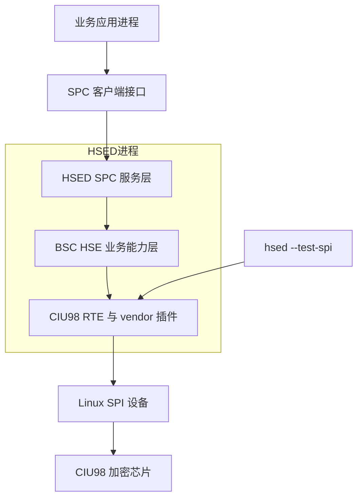

# HSED 硬件加密代理服务 功能需求说明文档

## 文档头部

| 项目名称 | HSED 硬件加密代理服务 |
|---|---|
| 版本号 | 1.0.1 |
| 实施日期 | 2026-08-03 |
| 保密级别 | 内部使用 |
| 文档依据 | 当前一期功能实现及已验证交付结论 |

### 更改记录

| 版本 | 日期 | 更改人 | 更改内容 |
|---|---|---|---|
| 1.0.0 | 2026-08-03 | Codex | 基于当前功能实现形成第一版完整功能需求说明；区分一期已交付能力和后续未实现需求 |
| 1.0.1 | 2026-08-03 | Codex | 调整为纯项目功能需求文档，删除内部开发过程及追溯信息 |

## 1. 引言

### 1.1 目的

本文档用于完整说明 HSED 硬件加密代理服务的用户功能、业务规则、异常行为、配置要求和验收重点，为开发、测试、系统集成、维护和后续接手人员提供统一需求基线。

本文档基于当前一期代码实现和已验证交付结论编写。若文档描述与当前实现存在差异，一期现状以代码及 `doc/hsed-handover.md` 的已验证结论为准；未实现内容作为后续需求单独说明，不得描述为当前能力。

### 1.2 范围

本文档覆盖以下内容：

- HSED 服务对象的创建、销毁、连接归属和属性管理；
- 数据加密、数据解密、数据签名和公钥导出；
- SM2 `USER_ID`、ZA 计算及签名身份隔离；
- CIU98 固定密钥槽位、属性默认值、启动校验和受控调试修复；
- SPI 基础通信自检、统一 SPC 服务和 CIU98 串行访问；
- 配置加载、错误码、并发隔离、密钥安全和诊断要求；
- 尚未交付的 SPI 退出低功耗、`CHIP_ID`、公钥导入和固定密钥全量补齐需求。

当前阶段不包含私钥导入/导出、验签、业务密钥生成、密钥删除、独立摘要、随机数和固件升级接口。

### 1.3 目标读者

- 开发人员：依据功能边界维护 HSED、BSC HSE、SPC 适配及 CIU98 适配代码；
- 测试人员：依据功能规则、异常结果和验收重点设计测试；
- 系统集成人员：完成配置、部署、固定槽位预置、设备自检和运行环境确认；
- 密钥管理员：理解固定密钥槽位、只读限制和维护模式风险；
- 项目及维护人员：掌握一期交付范围、后续需求和已知限制。

### 1.4 术语说明

| 术语 | 解释说明 |
|---|---|
| HSED | Hardware Security Encryption Daemon，运行于 MPU Linux 的硬件加密代理服务 |
| SPC | 进程间同步 RPC 通信框架，业务应用通过 SPC 调用 HSED |
| BSC HSE | HSED 内部面向业务的硬件密码能力组件，隔离上层协议与供应商 SDK |
| CIU98 | HSED 当前适配的硬件加密芯片 |
| HSE 对象 | 调用方通过 `HseCreate` 创建的功能对象，保存本连接的密码属性上下文 |
| handle | HSE 对象句柄，仅允许创建该对象的 SPC 客户端连接使用 |
| key_id | CIU98 硬件密钥槽位编号，不表示用户、进程、连接或会话 |
| USER_ID | 对象级二进制用户标识；SM2 签名使用其前 16 字节参与 ZA 派生 |
| ZA | SM2 签名使用的用户身份摘要，由用户标识、公钥及曲线参数共同派生 |
| 固定槽位 | 为特定算法和密钥角色预先约定的 CIU98 槽位 |
| vendor 插件 | 运行时动态加载的 CIU98 供应商适配共享库 |

### 1.5 项目背景

HSED 面向车载 MPU Linux 环境，为多个业务进程提供统一的硬件密码能力。上层应用不直接访问 SPI 或供应商 SDK，而是通过 SPC RPC 调用 HSED；HSED 在服务内部维护连接与对象归属、校验属性和固定槽位，并串行访问 CIU98，从而避免多进程直接竞争硬件、接口语义不一致及私钥材料离开芯片。

## 2. 总体架构设计

### 2.1 分层架构

业务调用采用“SPC 连接 → HSE 对象 → 属性上下文 → 密码操作”的模型。HSED 可同时服务多个客户端连接，但所有 CIU98 设备访问必须在服务内部串行化。`hsed --test-spi` 是独立的基础通信烟测入口，不启动 SPC 业务服务，也不等同于供应商全量 API 示例测试。

### 2.2 功能需求总览表

| 需求编号 | 功能名称 | 交付状态 | 功能描述 |
|---|---|---|---|
| FR-HSE-001 | 算法与属性标识 | 一期已实现 | 统一算法、属性和业务结果标识，保证接口语义稳定 |
| FR-HSE-002 | SM2 用户标识与 ZA | 一期已实现 | 使用对象 `USER_ID` 前 16 字节派生 ZA，保护 SM2 签名身份语义 |
| FR-HSE-003 | SPI 通信自检 | 一期已实现 | 提供 CIU98 基础通信烟测和明确进程退出码 |
| FR-HSE-004 | BSC HSE 组件化服务 | 一期已实现 | 通过 11 项 SPC RPC 提供统一硬件密码服务并串行访问芯片 |
| FR-HSE-005 | 加密芯片对象管理 | 一期已实现 | 管理最多 8 个对象、连接归属、属性上下文和断连清理 |
| FR-HSE-006 | 数据加密 | 一期已实现 | 使用固定对称密钥或非对称公钥槽位完成数据加密 |
| FR-HSE-007 | 数据解密 | 一期已实现 | 使用固定对称密钥或非对称私钥槽位完成数据解密 |
| FR-HSE-008 | 数据签名 | 一期已实现 | 使用固定私钥槽位签名，并返回稳定的签名格式 |
| FR-HSE-009 | 公钥导出 | 一期已实现 | 从固定非对称公钥槽位完整导出 BIN 公钥，禁止私钥导出 |
| FR-HSE-010 | 默认属性与固定槽位 | 一期已实现 | 新对象加载 45 个可用属性，固定槽位只读并支持四类非对称密钥校验/修复 |
| FR-HSE-011 | 退出 SPI 低功耗 | 后续未实现 | 可控退出时将四路 SPI 引脚切换为规定 GPIO 电平 |
| FR-HSE-012 | CHIP_ID 读取与首次配置 | 后续未实现 | 读取芯片标识并在授权条件下完成一次性首次配置 |
| FR-HSE-013 | 公钥导入与受控覆盖 | 后续未实现 | 向独立业务公钥槽位安全导入并受控覆盖公钥 |
| FR-HSE-014 | 固定密钥全量自动补齐 | 后续未实现 | 对固定槽位 1～14 执行安全检查与缺失密钥补齐 |

## 3. 功能要求

### 3.1 算法、属性与结果标识（FR-HSE-001）

#### 3.1.1 功能描述

HSED 应向 SPC 模型、BSC HSE 和 CIU98 适配层提供稳定一致的算法、属性和业务结果标识。调用方传入未知、保留或当前物料不支持的标识时，HSED 应明确拒绝，不得静默替换算法或回退到软件实现。

#### 3.1.2 功能点

- 一期主算法标识包括 AES128、TDES128、SM1、SM4、RSA1024、RSA2048、ECC256、SM2 和 SM9；摘要标识包括 SHA1、SHA256、SHA384、SHA512 和 SM3。
- SHA224、AES192、AES256、RSA3072、RSA4096 等保留值不得作为一期已支持能力开放。
- 属性标识采用 `0x00AAAAPP` 结构表达算法域和属性域；模型中的数值、名称和类型必须保持稳定。
- 业务结果统一使用 `OK`、`INVALID_PARAM`、`UNSUPPORTED`、`PERMISSION_DENIED` 等结果，不得用传输成功掩盖业务失败。
- 二进制数据必须按显式长度处理，不得依赖字符串结束符。

### 3.2 BSC HSE 组件与公共 RPC（FR-HSE-004）

#### 3.2.1 功能描述

HSED 应通过 BSC HSE 组件隔离 SPC 协议与供应商 SDK，并向业务应用提供稳定的同步 RPC。供应商实现以动态共享库方式加载，业务层不得直接依赖供应商私有接口。

#### 3.2.2 公共接口

| RPC | 功能 | 一期行为 |
|---|---|---|
| `HseCreate` | 创建对象 | 创建连接私有对象并返回 handle |
| `HseDestroy` | 销毁对象 | 仅销毁当前连接拥有的对象 |
| `SetPropertyInt` | 设置整数属性 | 校验属性、权限和值域后更新对象上下文 |
| `SetPropertyBytes` | 设置字节属性 | 按二进制长度保存；`CHIP_ID` 当前不支持 |
| `GetPropertyInt` | 读取整数属性 | 返回对象当前值或默认值 |
| `GetPropertyBytes` | 读取字节属性 | 返回完整字节值；`CHIP_ID` 当前不支持 |
| `Encrypt` | 数据加密 | 使用固定对称密钥或非对称公钥槽位 |
| `Decrypt` | 数据解密 | 使用固定对称密钥或非对称私钥槽位 |
| `Sign` | 数据签名 | 使用固定私钥槽位；SM2 执行 ZA 身份处理 |
| `ExportPublicKey` | 公钥导出 | 从固定公钥槽位导出 BIN 公钥 |
| `ImportPublicKey` | 公钥导入 | 兼容保留；合法对象固定返回 `PERMISSION_DENIED`，不访问芯片 |

#### 3.2.3 功能点

- SPC 传输结果与 HSED 业务结果必须分别表达，调用方需同时检查。
- 服务必须在访问供应商插件和 CIU98 前完成参数、对象归属、属性、槽位角色和缓冲区容量校验。
- 多连接可并发提交请求，但 CIU98 调用必须串行执行；不得因并发导致对象属性、临时 ZA、输入或响应串线。
- 供应商插件加载失败、符号不完整或设备初始化失败时，不得开放表面可用但实际失效的 SPC 服务。
- 当前物料不支持的算法、模式或能力返回 `UNSUPPORTED`，不得软件回退。

### 3.3 对象与属性管理（FR-HSE-005、FR-HSE-010）

#### 3.3.1 对象生命周期

- HSED 同时最多维护 8 个有效 HSE 对象；资源耗尽时返回 `NO_RESOURCE`。
- handle 必须绑定创建它的 SPC 客户端连接，不允许跨连接、跨进程共享。
- 销毁对象后，该 handle 立即失效；重复销毁或继续使用应返回对象不存在类错误。
- SPC 连接断开时，HSED 必须自动清理该连接遗留的全部对象。
- 不同对象的可写属性相互独立；固定槽位和默认值规则保持一致。

#### 3.3.2 属性要求

- 当前接口模型声明 46 个属性，其中 `CHIP_ID` 尚未实现；一期可使用其余 45 个属性。
- `USER_ID` 是 0～128 字节对象私有二进制属性，默认长度为 0。
- AES128、SM1、SM4 的 IV 长度为 16 字节；TDES128 的 IV 长度为 8 字节；IV 默认未设置。
- CBC 等需要 IV 的模式在 IV 未设置或长度错误时返回 `OBJECT_STATE_ERROR` 或 `INVALID_PARAM`，不得使用隐含零 IV。
- 所有 `KEY_ID`、`PUBLIC_KEY_ID` 和 `PRIVATE_KEY_ID` 均为只读固定值，修改请求返回 `PERMISSION_DENIED`，原值不变。
- 新对象的对称算法模式默认 ECB、填充默认 NONE；RSA 默认 PKCS1 填充；RSA/ECC 默认 SHA256；SM2/SM9 默认 SM3；签名输入模式默认 MESSAGE；SM9 模式默认 STREAM；公钥格式默认 BIN。

#### 3.3.3 固定密钥槽位

| 算法 | 对称密钥槽位 | 公钥槽位 | 私钥槽位 |
|---|---:|---:|---:|
| AES128 | 1 | - | - |
| TDES128 | 2 | - | - |
| SM1 | 3 | - | - |
| SM4 | 4 | - | - |
| RSA1024 | - | 5 | 6 |
| RSA2048 | - | 7 | 8 |
| ECC256 | - | 9 | 10 |
| SM2 | - | 11 | 12 |
| SM9 | - | 13 | 14 |
| 保留槽位 15～24 | - | - | - |

> 注：槽位 15～24 不由一期客户端使用。槽位 1～14 是算法与角色映射，不表示槽位中的密钥一定已预置。业务加解密和签名前，系统集成人员必须保证目标槽位存在匹配密钥。

#### 3.3.4 启动校验与维护模式

- `debug=0` 时，HSED 启动前校验 RSA1024、RSA2048、ECC256、SM2 固定公钥槽位的算法和长度；校验失败时不得开放 SPC 服务，也不得覆盖密钥。
- `debug=1` 仅用于受控维护环境，可重新建立上述四类异常非对称密钥对；修复后必须再次校验通过才可开放服务。
- 调试修复可能覆盖原槽位密钥，普通客户端不得触发该行为。
- 当前芯片不能读取私钥内容或角色；启动校验只能以可导出的公钥算法和长度作为对应密钥对类型判据。
- 对称槽位 1～4 和 SM9 槽位 13/14 的自动生成不属于一期能力。

### 3.4 数据加密（FR-HSE-006）

#### 3.4.1 功能描述

调用方可使用对象当前配置的固定对称密钥槽位或非对称公钥槽位加密二进制数据，并获得完整密文及实际长度。

#### 3.4.2 功能点

- 对称加密使用算法对应的固定对称密钥槽位；非对称加密只能使用算法对应的固定公钥槽位。
- 加密前应校验对象、算法、模式、填充、IV、槽位和输入长度之间的一致性。
- 空输入、非法块长度、错误 IV、错误槽位角色或算法不匹配时应明确失败。
- 输出容量不足时返回 `DATA_TOO_LARGE`，不得返回截断密文或部分成功。
- 设备或物料不支持的组合返回 `UNSUPPORTED`，不得更换算法、密钥或软件回退。
- 密钥缺失、设备不可用或供应商调用失败时不得返回看似有效的密文。

### 3.5 数据解密（FR-HSE-007）

#### 3.5.1 功能描述

调用方可使用对象当前配置的固定对称密钥槽位或非对称私钥槽位解密二进制密文，并获得完整明文及实际长度。

#### 3.5.2 功能点

- 对称解密使用与加密相同的固定对称密钥槽位；非对称解密只能使用算法对应的固定私钥槽位。
- 解密属性必须与产生密文时的算法、模式、填充和 IV 匹配。
- 密文格式、长度、填充或槽位不合法时应明确失败，不得返回部分明文。
- 输出容量不足时返回 `DATA_TOO_LARGE`，不得截断明文。
- 私钥材料不得导出、记录日志或暴露给调用方。
- 不支持的组合返回 `UNSUPPORTED`，不得软件回退。

### 3.6 数据签名与 SM2 身份保护（FR-HSE-002、FR-HSE-008）

#### 3.6.1 功能描述

调用方可使用 RSA1024、RSA2048、ECC256、SM2 或 SM9 的固定私钥槽位对完整原文或受支持的预计算摘要签名。签名结果必须具有稳定格式；SM2 签名必须绑定当前对象的 `USER_ID` 身份上下文。

#### 3.6.2 通用签名规则

- 签名只能使用算法对应的固定私钥槽位；公钥槽位、算法不匹配槽位或不存在槽位必须被拒绝。
- MESSAGE 模式由 HSED/CIU98 按当前 `HASH_ALGORITHM` 处理原文；DIGEST 模式不得再次摘要，输入长度必须严格匹配摘要算法。
- ECC256 和 SM2 签名按 `r || s` 返回，并满足 `r_size + s_size = 签名实际长度`；RSA 等非分量格式返回 `r_size=0`、`s_size=0`。
- 输出容量不足返回 `DATA_TOO_LARGE`，不得返回截断或部分签名。
- 当前物料不支持的算法、摘要或模式返回 `UNSUPPORTED`，不得软件签名。

#### 3.6.3 SM2 USER_ID 与 ZA 规则

- SM2 签名前，对象必须已设置不少于 16 字节的 `USER_ID`；缺失或不足 16 字节返回 `INVALID_PARAM`。
- `USER_ID` 超过 16 字节时，本次 SM2 签名只使用前 16 字节；第 17 字节及之后不得参与 ZA。
- HSED 必须从对象当前 SM2 公钥槽位导出 64 字节公钥，以 `USER_ID[0..15]` 和该公钥计算 ZA，再按 `ZA || M` 语义执行 SM2+SM3 签名。
- 不得用 `CHIP_ID`、槽位号、会话标识或默认字符串代替 `USER_ID`，也不得把 16 字节身份值直接当成 ZA。
- 当前 CIU98 物料不能保持正确 ZA 语义地执行 SM2 DIGEST 模式，因此该模式返回 `UNSUPPORTED`。
- 不同连接、对象或线程的 `USER_ID`、ZA 临时数据和签名响应不得串线。

### 3.7 公钥导出与导入兼容行为（FR-HSE-009）

#### 3.7.1 功能描述

调用方可从 RSA1024、RSA2048、ECC256、SM2、SM9 的固定公钥槽位导出 BIN 原始公钥，用于密钥分发或外部验签；任何一期接口均不得导出私钥。

#### 3.7.2 功能点

- 公钥导出只接受非对称算法，并按算法选择固定公钥槽位。
- 调用方不能通过属性修改槽位引用，也不能要求从私钥槽位导出数据。
- 输出容量不足返回 `DATA_TOO_LARGE`，不得把截断数据报告为成功。
- 槽位为空、算法或角色不匹配、设备异常时明确失败，不得转到其他槽位。
- 一期保留 `ImportPublicKey` RPC 以维持接口兼容，但对合法对象固定返回 `PERMISSION_DENIED`，且不得访问或修改芯片槽位。

### 3.8 SPI 基础通信自检（FR-HSE-003）

#### 3.8.1 功能描述

系统集成和测试人员可执行 `hsed --test-spi [--cfg <path>]`，使用指定或默认配置加载 vendor 插件并对 CIU98 执行只读基础通信烟测。

#### 3.8.2 功能点

- 自检模式不得启动 SPC 服务，不得生成、删除、导入或覆盖密钥。
- 未指定配置路径时使用 `/etc/hsed.ini`；`--cfg` 用于覆盖配置文件路径。
- 自检按配置打开 SPI 设备并初始化 vendor 插件，输出可定位配置、插件、设备和通信阶段的诊断信息。
- 自检成功退出码为 0；命令行错误为 2；配置加载失败为 3；vendor 插件加载或接口解析失败为 4；设备初始化或基础通信失败为 5。
- `--test-spi` 仅证明当前配置下 CIU98 基础通信可用，不代表所有密码算法、固定密钥槽位或供应商全量 API 均已验证。

### 3.9 后续未实现需求

本节内容不属于一期已交付能力。开发前需完成需求评审、技术方案、硬件或权限前置条件和测试验收，不得仅修改文档状态即宣称完成。

#### 3.9.1 退出 SPI 引脚低功耗（FR-HSE-011）

- HSED 正常返回、`SIGINT`/`SIGTERM`、自检结束及初始化失败等可控退出路径应汇聚到统一低功耗清理。
- 清理完成后，`SPI_CS`、`SPI_SCK`、`SPI_MISO`、`SPI_MOSI` 均应切换为 GPIO。
- 目标电平为：`SPI_CS=高`、`SPI_SCK=低`、`SPI_MISO=高`、`SPI_MOSI=高`。
- 单路设置失败时仍应尝试其余引脚，并记录失败引脚和阶段；清理应具备幂等性。
- 目标板约定条件下 CIU98 Standby 功耗目标小于 `200 µA`。
- `SIGKILL`、崩溃、系统失效和突然掉电不属于用户态退出清理保证范围。
- 当前状态：未实现；GPIO 编号、复用方式和系统级兜底方案仍需技术确认。

#### 3.9.2 CHIP_ID 读取与首次配置（FR-HSE-012）

- `CHIP_ID` 应按 1～128 字节原始二进制处理，并作为芯片全局数据而非对象私有数据。
- 仅在明确确认尚未配置且调用方具备权限时允许首次写入；后续写入不得覆盖原值。
- 通信异常、认证失败或状态未知不得解释为“未配置”。
- 当前状态：`SetPropertyBytes(CHIP_ID)` 和 `GetPropertyBytes(CHIP_ID)` 均返回 `UNSUPPORTED`。

#### 3.9.3 公钥导入与受控覆盖（FR-HSE-013）

- 只允许导入公钥，禁止导入私钥；格式、长度、算法和槽位角色必须一致。
- 固定槽位 1～24 默认受保护，在建立独立业务槽位和权限模型前不得开放导入。
- 覆盖必须同时满足管理权限、目标槽位可覆盖且无活动使用；失败时原槽位保持不变。
- 并发导入同一槽位时最多一个完整操作成功，不得产生部分写入。
- 当前状态：`ImportPublicKey` 固定返回 `PERMISSION_DENIED`，不访问芯片。

#### 3.9.4 固定密钥全量自动补齐（FR-HSE-014）

- 目标范围为对称槽位 1～4、非对称槽位 5～12 和 SM9 槽位 13/14。
- 只有明确确认槽位为空时才允许补齐；通信失败、认证失败、算法/角色错误或未知状态不得按空槽处理。
- 对称密钥和 SM9 必须使用经批准的安全生成或注入来源，不得使用临时固定值。
- 生产模式不得自动覆盖已有密钥；全部必需槽位复查通过后才能报告完整就绪。
- 当前状态：一期只实现 RSA1024、RSA2048、ECC256、SM2 的启动校验及 `debug=1` 受控修复，对称密钥和 SM9 自动补齐未实现。

## 4. 非功能性需求

### 4.1 正确性与互操作性

- 算法、属性、槽位、签名格式和错误码在 SPC、BSC HSE 与 CIU98 适配层之间必须一致。
- 加密、解密、签名和公钥导出结果应可由约定的标准或供应商工具验证。
- 所有输入输出按二进制长度处理，失败时不得返回部分明文、密文、签名或公钥。

### 4.2 并发与资源

- HSED 最多维护 8 个对象，并对对象资源耗尽给出明确结果。
- 对象和 handle 必须按 SPC 连接隔离；连接断开后自动清理。
- 多客户端可并发请求，CIU98 硬件访问必须串行，响应和临时身份数据不得串线。
- HSED 应使用 `/tmp/hsed-ciu98.lock` 防止多个进程同时占用同一 CIU98 设备。

### 4.3 可靠性与可诊断性

- 配置、vendor 插件、SPI 设备、固定槽位校验或业务调用失败时，应记录足以定位阶段的日志。
- 自检必须使用稳定退出码表达失败阶段。
- 初始化失败时不得开放不可用的 SPC 服务；业务失败不得被传输层成功掩盖。
- 日志不得输出私钥、完整敏感明文或其他不必要的密钥材料。

### 4.4 安全性

- 私钥必须保留在 CIU98 内部，不提供导入、导出或读取接口。
- 固定槽位属性只读，普通客户端不能修改、修复或覆盖密钥。
- 生产环境必须使用 `debug=0`，禁止自动覆盖异常槽位密钥。
- SM2 签名必须绑定对象 `USER_ID`，不同连接身份上下文不得相互替代。
- 物料不支持的能力必须明确拒绝，不得通过软件回退绕过硬件密钥边界。

### 4.5 可维护性

- 对外接口权威模型为 `doc/hsed.xlsx`，生成接口应通过 `doc/spc-build.bat` 维护，避免手工修改生成物造成漂移。
- INI 配置统一通过项目规定的 `TCIni` 接口读取；操作系统相关能力优先使用公司 SFC 组件接口。
- vendor 插件路径、SPI 设备路径和维护模式应由配置管理，不得散落硬编码。
- 新增能力应先完成需求评审并更新本需求说明及相关设计文档，再进入实现和验收。

## 5. 异常处理

### 5.1 业务结果及处理策略

| 业务结果 | 数值 | 典型场景 | 处理要求 |
|---|---:|---|---|
| `OK` | 0 | 操作完整成功 | 返回有效输出及实际长度 |
| `INVALID_PARAM` | -1 | 空输入、长度错误、SM2 USER_ID 不足、槽位角色错误 | 拒绝调用，不访问或不继续访问芯片 |
| `UNSUPPORTED` | -2 | 算法/模式不支持、CHIP_ID 当前不可用、SM2 DIGEST 模式 | 明确返回，不软件回退 |
| `PERMISSION_DENIED` | -3 | 修改固定槽位、一期公钥导入 | 保持原状态不变 |
| `KEY_NOT_FOUND` | -4 | 固定槽位无匹配密钥 | 不切换到其他槽位 |
| `KEY_OCCUPIED` | -5 | 后续首次配置或禁止覆盖场景 | 保留已有数据 |
| `BUSY` | -6 | 资源正在被占用 | 调用方可按业务策略稍后重试 |
| `OBJECT_NOT_FOUND` | -7 | 无效、已销毁或非本连接 handle | 不执行业务操作 |
| `OBJECT_STATE_ERROR` | -8 | 所需属性或 IV 未设置 | 调用方补齐对象状态后重试 |
| `DATA_TOO_LARGE` | -9 | 输出容量不足或数据超限 | 不返回截断结果 |
| `NO_RESOURCE` | -10 | 已达到对象上限等 | 释放资源后重试 |
| `TIMEOUT` | -11 | 设备或调用超时 | 记录阶段并按系统策略恢复 |
| `DEVICE_UNAVAILABLE` | -12 | 插件、SPI 或芯片不可用 | 不开放或停止相关业务能力 |
| `AUTH_LOCKED` | -13 | 芯片认证锁定 | 禁止绕过认证，进入维护流程 |
| `DEVICE_ERROR` | -14 | 其他供应商或硬件错误 | 记录原始诊断并返回统一结果 |

### 5.2 SPI 自检进程退出码

| 退出码 | 含义 |
|---:|---|
| 0 | 基础通信自检成功 |
| 2 | 命令行参数错误 |
| 3 | 配置文件加载或配置项错误 |
| 4 | vendor 插件加载或接口解析失败 |
| 5 | CIU98 设备初始化或基础通信失败 |

## 6. 配置项汇总

默认配置文件为 `/etc/hsed.ini`，也可通过 `--cfg <path>` 指定其他 INI 文件。配置加载应统一使用 `TCIni` 接口。

| 配置节 | 配置项 | 默认值/要求 | 功能说明 |
|---|---|---|---|
| `[spi]` | `device_path` | `/dev/spidev1.0` | CIU98 对应 Linux SPI 设备路径 |
| `[bsc_hse]` | `vendor_so_path` | 部署时必须为有效共享库路径 | CIU98 vendor 插件路径 |
| `[bsc_hse]` | `debug` | `0` | `0` 为生产校验模式；`1` 为受控维护修复模式 |

配置文件缺失、格式错误、必需值无效或共享库不可加载时，应明确失败并记录配置来源；不得在生产环境静默进入 `debug=1`。

## 7. 测试建议

### 7.1 功能测试

- 验证 11 项 SPC RPC 的正常、非法参数和跨连接调用行为。
- 创建 8 个对象并验证第 9 个创建失败；验证销毁、断连清理和 handle 失效。
- 逐项读取 45 个一期可用属性，验证默认值、对象隔离及固定槽位只读。
- 对各已支持算法执行代表性加密、解密、签名和公钥导出，并进行外部验证。
- 验证 CBC IV 未设置、错误长度、输出容量不足、错误槽位和不支持算法的结果。
- 验证 `ImportPublicKey` 返回 `PERMISSION_DENIED` 且槽位内容不变；验证 `CHIP_ID` 返回 `UNSUPPORTED`。

### 7.2 SM2 专项测试

- 使用 16 字节、少于 16 字节和超过 16 字节的 `USER_ID` 验证签名规则。
- 使用多个独立连接和随机 16 字节 `USER_ID` 对同一原文签名；每个签名只应通过本连接身份上下文的 ZA 验证。
- 验证 SM2 输出为 64 字节 `r || s`，并满足分量长度关系。
- 验证 SM2 DIGEST 模式、ZA 计算失败、公钥导出失败和公私钥不匹配均不返回部分签名。

### 7.3 集成与可靠性测试

- 分别验证正常配置、配置缺失、vendor 插件缺失、SPI 设备不可用和 CIU98 通信失败。
- 验证 `hsed --test-spi` 的 0/2/3/4/5 退出码，并确认自检不修改密钥。
- 多进程启动 HSED，验证 `/tmp/hsed-ciu98.lock` 防止重复占用设备。
- 多线程、多连接并发执行密码操作，验证硬件串行访问、对象隔离和响应不串线。
- 分别以 `debug=0` 和 `debug=1` 验证四类非对称固定槽位的启动校验、拒绝启动和受控修复。

### 7.4 后续需求测试边界

- 一期验收不得把 SPI 退出 GPIO 电平、CHIP_ID、公钥实际导入、对称密钥或 SM9 自动补齐列为已交付通过项。
- 后续功能实施时，应分别依据 3.9.1～3.9.4 的需求建立专项验收用例；涉及密钥覆盖和 GPIO/功耗的测试必须在受控设备上进行。

## 8. 总结与建议

### 8.1 总结

HSED 一期已形成以 SPC 为入口、BSC HSE 为业务隔离层、CIU98 vendor 插件为硬件适配层的统一硬件密码服务。当前交付覆盖对象和属性管理、数据加密、数据解密、数据签名、公钥导出、SPI 基础通信自检、固定槽位默认映射及四类非对称密钥启动校验/受控修复。

一期能力依赖目标设备已正确部署 vendor 插件，并在固定槽位中预置业务所需密钥。`ImportPublicKey` 仅保留接口兼容行为，`CHIP_ID`、SPI 退出低功耗和固定密钥全量自动补齐均未实现。

### 8.2 建议

- 生产部署固定使用 `debug=0`，在上线前完成 SPI 自检、固定非对称槽位校验和代表性密码业务验证。
- 将固定槽位预置、配置文件、vendor 插件及目标板验证记录纳入交付清单。
- 后续分别完成 SPI 退出低功耗、CHIP_ID、公钥导入和固定密钥全量补齐所需的硬件映射、权限模型、安全密钥来源及验收方案，不将多项高风险能力合并为隐式实现。
- 接口模型变化时同步更新 `doc/hsed.xlsx`、生成代码、本需求说明和客户端接口文档。

### 8.3 结论

本文档可作为 HSED 一期功能验收和后续维护的汇总需求基线。开发和测试人员应依据文中的 `FR-HSE-*` 需求编号开展设计、实现和测试，并严格区分“一期已实现”和“后续未实现”状态。
