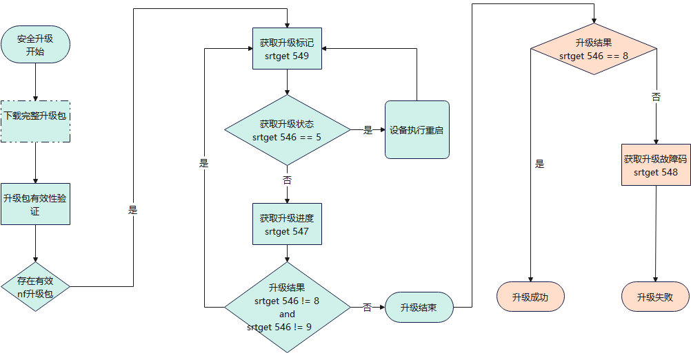
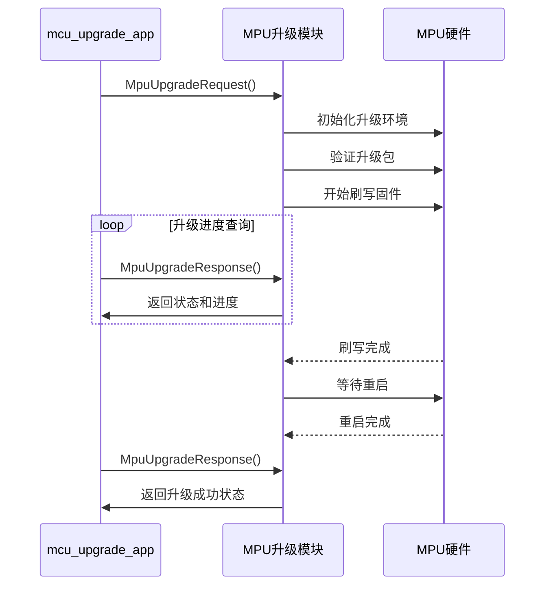
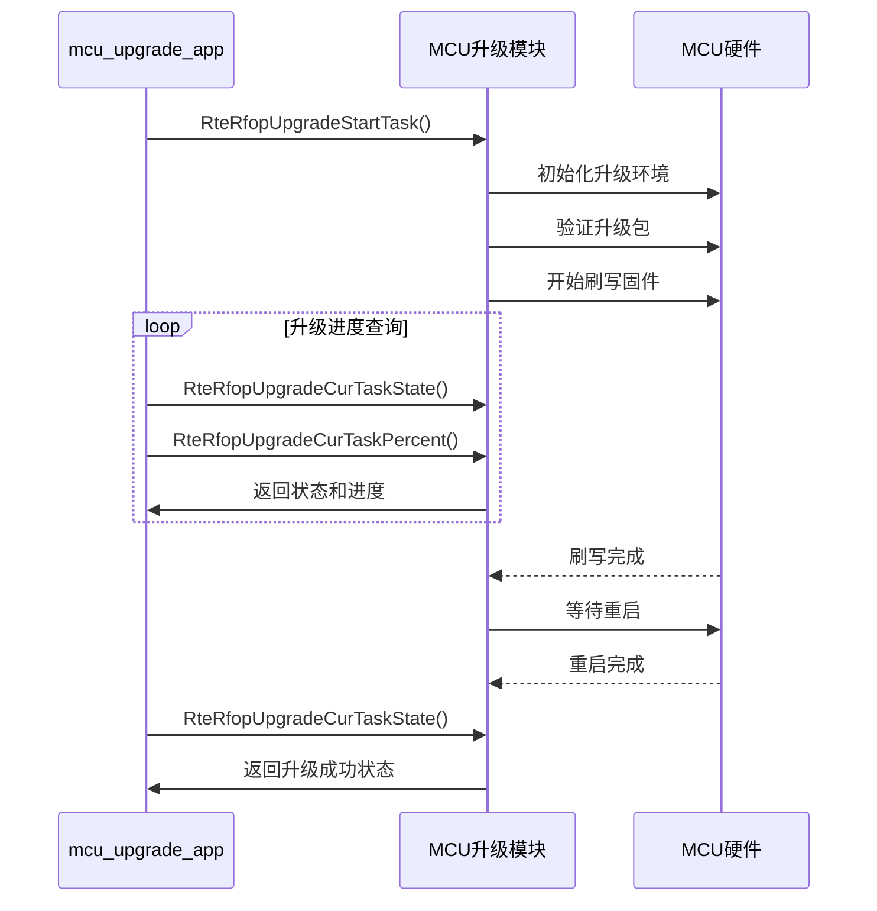
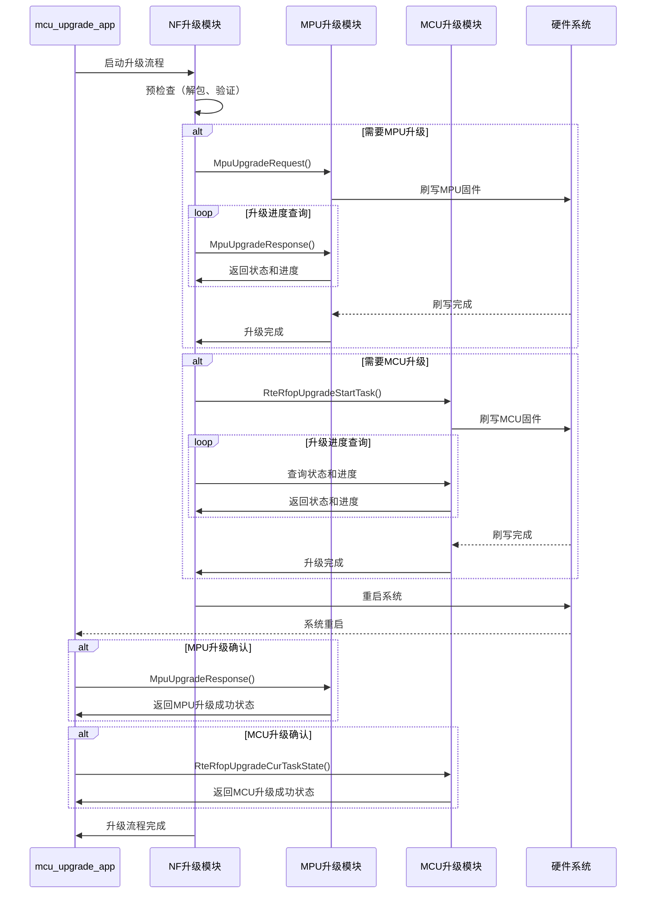

# mcu_upgrade_app

## 项目概述

mcu_upgrade_app 是一个用于 MPU（主处理器）和 MCU（微控制器）固件升级的应用程序，支持基于本地文件的固件升级功能。该项目主要用于嵌入式系统中，提供了完整的升级流程管理、状态监控和错误处理机制。

## 功能特性

### 核心功能
- **MPU 升级功能**：支持 MPU 固件的检测、验证和刷写
- **MCU 升级功能**：支持 MCU 固件的检测、验证和刷写
- **NF 升级功能**：支持基于 NFCreator.img 包的完整升级流程
- **状态管理**：提供实时的升级状态查询和进度监控
- **错误处理**：完善的错误检测和处理机制，确保升级过程的可靠性
- **掉电恢复**：支持升级过程中掉电后恢复升级状态

### 技术特性
- **多平台支持**：支持多种硬件平台，包括 AG35_ASR1806、AG35_CEVN、SIM7805 等
- **模块化设计**：采用模块化架构，便于维护和扩展
- **日志系统**：内置文件日志系统，记录升级过程和错误信息
- **命令行界面**：提供命令行交互功能，便于手动操作和测试
- **HTTP 下载**：支持通过 HTTP 协议下载升级包

## 项目结构

```
mcu_upgrade_app/
├── build/             # 构建脚本和配置
│   ├── ac8257_64bit/  # AC8257 64位平台构建配置
│   ├── common/        # 通用构建配置
│   ├── build.sh       # 构建脚本
│   └── debug.bat      # 调试脚本
├── cmdline/           # 命令行界面实现
│   ├── cmdline.c      # 命令行处理
│   ├── cmdline.h      # 命令行头文件
│   ├── http_download.c # HTTP 下载实现
│   └── http_download.h # HTTP 下载头文件
├── common/            # 通用功能实现
│   ├── a_log_backend_file_impl.c # 日志后端文件实现
│   ├── a_log_backend_file_impl.h # 日志后端文件头文件
│   ├── mcu_upgrade_app.c # 主应用实现
│   ├── mpu_upgrade_app.c # MPU 升级应用实现
│   ├── mpu_upgrade_app.h # MPU 升级应用头文件
│   ├── nf_upgrade_app.c # NF 升级应用实现
│   ├── nf_upgrade_app.h # NF 升级应用头文件
│   ├── nf_upgrade_state_exec.c # NF 升级状态执行
│   ├── nf_upgrade_state_exec.h # NF 升级状态执行头文件
│   └── upgrade_app_cfg.h # 升级应用配置
├── docs/              # 文档目录
│   └── mcu_upgrade_app_version_history.md # 版本历史
├── file_log/          # 文件日志实现
│   ├── file_log.c     # 文件日志实现
│   └── file_log.h     # 文件日志头文件
├── mpu_upgrade/       # MPU 升级实现
│   └── common/        # 通用 MPU 升级代码
│       ├── include/   # 头文件
│       │   └── mpu_upgrade.h # MPU 升级头文件
│       ├── mpu_upgrade_ag35_asr1806.c # AG35 ASR1806 平台实现
│       ├── mpu_upgrade_ag35_cevn.c # AG35 CEVN 平台实现
│       └── mpu_upgrade_sim7805.c # SIM7805 平台实现
├── rfop_server/       # RFOP 服务器实现
│   ├── rte_rfop_server/ # RFOP 服务器
│   ├── rte_terminal_ota/ # 终端 OTA 实现
│   └── se_img/        # 安全镜像实现
└── README.md          # 项目说明文档
```

## 构建方法

### 前提条件
- 支持的硬件平台：AG35_ASR1806、AG35_CEVN、AR590、SIM7805
- 交叉编译工具链
- CMake 构建系统

### 构建步骤

1. **配置构建环境**
   - 设置交叉编译工具链路径
   - 配置 CMake 构建参数

2. **执行构建脚本**
   ```bash
   # Linux 平台
   cd build
   ./build.sh
   
   # Windows 平台
   cd build\ac8257_64bit
   .\build.bat
   ```

3. **构建结果**
   构建完成后，可执行文件将生成在指定的输出目录中。

## 使用说明

### 状态查询

应用程序运行过程中，用户可以通过以下方式查询升级状态：

1. **日志文件**：查看日志目录中的日志文件

2. **srt属性查询状态**：通过 srtget xxx 查询升级过程

   

## 配置说明

### 日志配置
- 日志文件目录：`LOG_FILE_DIR`
- 日志文件大小：`LOG_FILE_SIZE`
- 日志文件数量：`LOG_FILE_COUNT`
- 日志文件前缀：`LOG_FILE_TAG`

### 升级配置
- 升级文件路径：通过命令行参数指定
- 升级超时时间：可在代码中配置
- 升级重试次数：可在代码中配置

## 错误处理

### 常见错误代码

#### MPU 升级错误
- `kMpuUpgradeErrNone` (0): 无错误
- `kMpuUpgradeErrInvalidParam` (-1): 参数错误
- `kMpuUpgradeErrInvalidState` (-2): 状态错误
- `kMpuUpgradeErrInvalidPath` (-3): 文件路径错误
- `kMpuUpgradeErrTimeout` (-4): 操作超时
- `kMpuUpgradeErrOptFailed` (-5): 操作失败
- `kMpuUpgradeErrInvalidFile` (-6): 文件错误

#### NF 升级错误
- `kNfUpgradeErrCodeSuccess` (1): 成功
- `kNfUpgradeErrCodeFailed` (0): 未知错误
- `kNfUpgradeErrCodeMpuUpgrade` (-1): MPU 升级异常
- `kNfUpgradeErrCodeMcuUpgrade` (-2): MCU 升级异常
- `kNfUpgradeErrCodeMcuWaitConf` (-4): MCU 等待确认超时
- `kNfUpgradeErrCodeMpuWaitConf` (-5): MPU 等待确认超时
- `kNfUpgradeErrCodeImgInvalid` (-6): 升级包无效
- `kNfUpgradeErrCodeInitFailed` (-7): 初始化失败
- `kNfUpgradeErrCodeMcuState` (-8): MCU 状态异常


## 升级交互时序图

### MPU 升级交互时序



### MCU 升级交互时序



### NF 完整升级交互时序



## 注意事项

1. **升级过程中请勿断电**：升级过程中断电可能导致系统无法启动
2. **使用正确的升级文件**：请确保使用与硬件平台匹配的升级文件
3. **预留足够的存储空间**：升级过程需要临时存储空间，请确保系统有足够的空间
4. **备份重要数据**：升级前请备份重要数据，以防升级过程中数据丢失
5. **测试环境验证**：在生产环境中使用前，请在测试环境中验证升级流程

## 联系方式

如有问题或建议，请联系：
- 项目维护者：靳普诏 (puzhao.jin@hopechart.com)
- 公司：杭州鸿泉物联网技术股份有限公司
