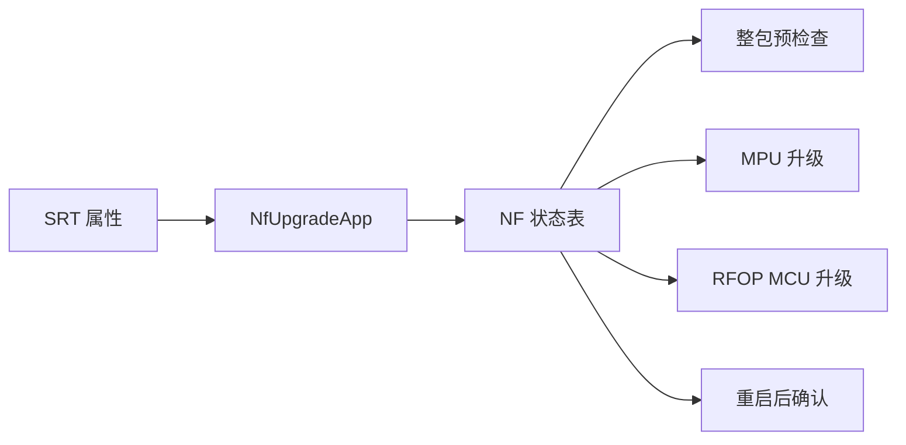

# 技术规范：NF 整包升级编排

## 基本信息

| 字段 | 内容 |
|---|---|
| 规范编号 | 0100 |
| 父规范编号 | 无 |
| 所属模块 | 升级业务 |
| 关联功能 | 0100 - NF 整包升级编排 |
| 创建日期 | 2026-08-03 |
| 状态 | 草稿（实现逆向基线） |

## 概述

当前实现以 `TNfUpgradeApp` 保存请求/响应 ID、百分比、错误码、标志和状态；循环调度状态表完成预检查、MPU、MCU、重启和确认。SRT 属性用于跨进程或重启后暴露并恢复任务。

## 关联功能与验收来源

| 来源 | 内容 |
|---|---|
| 功能规范 | `0100-nf-整包升级编排.spec.md` |
| 功能目标 | 整包升级、状态反馈与掉电恢复 |
| 验收标准 | [001]–[006]；本规范仅补充运行条件 |

## 技术选型

### 选型对比

| 层级 | 技术 | 选择理由 |
|---|---|---|
| 调度 | 单线程 `RunOnce` 状态机 | 已实现，避免升级流程阻塞主循环 |
| 状态持久化 | SRT 属性 | 已实现请求、响应、进度、错误、标志和状态同步 |
| 子任务 | MPU 与 RFOP 升级模块 | 已有独立执行和查询能力 |

### 最终决策

沿用现有单线程状态机、SRT 状态同步和 MPU/RFOP 子任务边界。

## 架构设计

| 模块 | 职责 | 接口 |
|---|---|---|
| `nf_upgrade_app` | 生命周期、请求/响应、SRT 同步 | `NfUpgradeRequest/Response/RunOnce` |
| `nf_upgrade_state_exec` | 状态进入、执行、跳转 | `g_nfupgrade_state_exec` |
| MPU/MCU 子模块 | 具体刷写与进度 | `MpuUpgrade*`、`RteRfopUpgrade*` |

## API 设计

| 调用面 | 输入 | 输出/约束 |
|---|---|---|
| `NfUpgradeRequest` | 请求 ID | 仅空闲、成功、失败状态可受理 |
| `NfUpgradeResponse` | 状态/进度/错误码指针 | 返回当前任务快照 |
| `NfUpgradeAppRecover` | 无 | 从升级标志恢复重启后的确认路径 |

## 数据模型

| 数据 | 字段 | 用途 |
|---|---|---|
| `TNfUpgradeApp` | `req_id/rsp_id/upgrade_precent/m_errcode/m_flag/m_state` | 任务状态单一事实源 |
| NF 状态 | Init、Idle、PreCheck、Mpu、Mcu、WaitReboot、Confirm、Success、Failed | 状态转换边界 |

## 部署架构

运行于嵌入式目标设备进程；由 `common/mcu_upgrade_app.c` 创建、初始化和循环驱动；需要本地升级存储、SRT 服务及相关子模块。

## 运行与验证条件

| 项目 | 内容 |
|---|---|
| 启动方式 | 运行应用主程序；内部调用 `NfUpgradeAppCreate/Init` |
| 关闭方式 | 主循环退出后调用 `NfUpgradeAppDone/Destroy` |
| 自动验证入口 | 当前仓库未发现自动化测试入口 |
| 人工验收前置条件 | 有效 NF 包、可用 MPU/MCU 硬件、可读取 SRT 状态 |

## 风险与决策

| 风险/决策 | 影响 | 处理方式 |
|---|---|---|
| 状态与 SRT 不一致 | 错误恢复或误触发 | 每轮 `RunOnce` 刷新状态；变更需回归掉电场景 |
| 重启发生在升级后 | 任务中断 | 以标志恢复至确认状态 |

## 许可证检查清单

| 检查项 | 结果 |
|---|---|
| 是否新增开源依赖 | 否 |
| 现有依赖许可证 | SRT、OFC 与厂商 SDK 的许可证未在本仓库明确，待项目审核确认 |
| 是否可商用 | 待确认现有依赖授权 |
| 替代方案 | 不涉及新增选型 |

## 备注

代码证据：`common/nf_upgrade_app.c:75`、`common/nf_upgrade_state_exec.c:878`。
