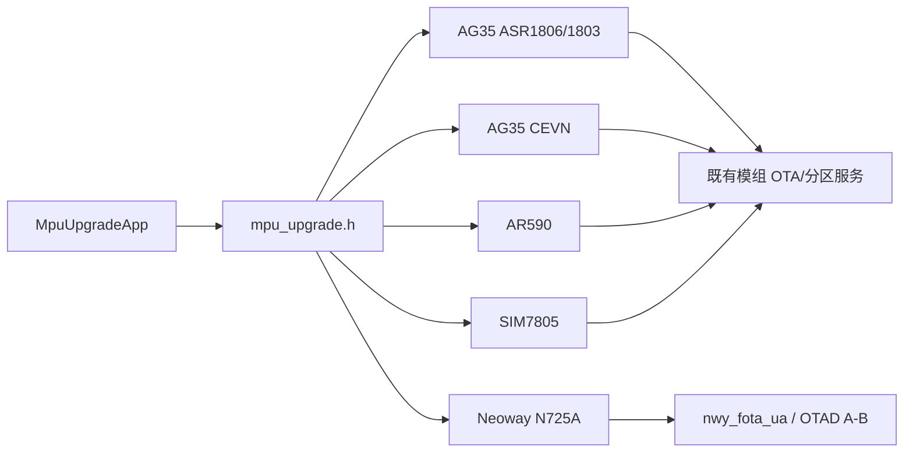

# 技术规范：MPU 固件升级与分区恢复

## 基本信息

| 字段 | 内容 |
|---|---|
| 规范编号 | 0200 |
| 父规范编号 | 无 |
| 所属模块 | MPU 升级 |
| 关联功能 | 0200 - MPU 固件升级与分区恢复 |
| 创建日期 | 2026-08-03 |
| 状态 | 已批准 |

## 概述

`mpu_upgrade.h` 提供统一契约，编译期根据 `HQ_CMAKE_BUILD_MODEL_TYPE` 选择一个平台实现。N725A 新增独立适配，通过有方 `nwy_fota_ua()` 提交整包升级，并使用正式 SDK 的结果和分区查询接口映射项目统一状态机。厂商未提供明确等价语义且不影响主升级正确性的备份、回滚接口采用受控 no-op 成功，关键分区数据只允许来自 SDK 查询结果。

## 关联功能与验收来源

| 来源 | 内容 |
|---|---|
| 功能规范 | `0200-mpu-固件升级与分区恢复.spec.md` |
| 功能目标 | 多平台 MPU 升级、备份和分区恢复，新增 N725A 适配 |
| 验收标准 | [001]–[010]；本规范只定义实现约束 |

## 技术选型

### 选型对比

| 层级 | 技术 | 选择理由 |
|---|---|---|
| 适配选择 | C 预处理编译期选择 | 强制只链接一个平台实现 |
| 执行 | 状态机 + 回调 | 上层可轮询且接收进度 |
| 分区管理 | 平台 OTA/AB FOTA 能力 | 复用模组厂商接口 |
| N725A FOTA | `nwy_fota_ua()` + 模组 OTAD A/B 流程 | 厂商整包升级入口 |
| N725A 辅助接口 | 受控 no-op 成功 | 维持统一流程；仅用于厂商未提供且无关键输出的操作 |

### 最终决策

沿用统一 C 抽象和编译期平台适配选择，不在运行时混用多个平台实现。N725A 独立实现，不复用移远 ASR1806 API；初始化/释放调用 `nwy_sdk_init()`/`nwy_sdk_deinit()`；备份、回滚直接成功；分区信息通过 SDK 查询；重启后使用 `nwy_get_fota_result()` 映射真实升级结果。

## 架构设计

| 模块 | 职责 | 接口 |
|---|---|---|
| `mpu_upgrade_app` | 上层请求和状态转发 | `MpuUpgradeRequest/Response` |
| `mpu_upgrade.h` | 跨平台抽象 | Init、SetImgPath、ExecUpdate/Backup/Rollback |
| 平台 `.c` | 调用厂商 OTA 并维护状态 | `MpuUpgradeRunOnce` |
| `mpu_upgrade_neoway_n725a.c` | N725A 状态机、路径校验和厂商返回值映射 | `nwy_fota_ua` |
| N725A 构建分支 | 选择型号宏、头文件和厂商链接库 | `BUILD_PLATFORM_NAME=n725a`；Neoway OpenWrt GCC 13.3.0 |

## API 设计

| 调用面 | 输入 | 输出/约束 |
|---|---|---|
| `MpuUpgradeSetImgPath` | 可变字符串路径 | 保存到平台上下文，长度受限 |
| `MpuUpgradeExecUpdate` | 超时、用户参数、回调 | 置升级请求；非合法超时使用默认 10 分钟 |
| `MpuUpgradeExecBackup` | 同上 | 置备份请求 |
| `MpuUpgradeGetPartitionInfo` | 输出结构 | 返回活动 A/B 分区和另一分区损坏标志 |

### N725A 接口映射

| 统一接口/状态 | N725A 适配行为 | 返回或状态 |
|---|---|---|
| `MpuUpgradeInit` | 调用 `nwy_sdk_init()` 并读取 `nwy_get_fota_result()` | 初始化失败返回负错误码；成功/失败/无记录映射统一状态 |
| `MpuUpgradeSetImgPath` | 校验非空与长度并保存整包路径 | 成功 `0`；非法路径返回负错误码 |
| `MpuUpgradeExecUpdate` | 记录请求、回调和超时参数，由 `RunOnce` 调用厂商 API | 受理返回 `0` |
| `MpuUpgradeRunOnce` | `Upgrading` 状态调用 `nwy_fota_ua(path)` | 厂商成功 → 100%/`WaitReboot`；失败 → `UpdateFailed` |
| `MpuUpgradeExecBackup` | N725A 无独立备份 API | no-op，返回 `0`；回调 100% |
| `MpuUpgradeExecRollback` | 厂商未提供主动回滚 API | no-op，返回 `0`；回调 100% |
| `MpuUpgradeGetPartitionInfo` | 调用活动槽位和损坏状态接口 | 只返回真实查询数据；SDK 失败返回统一错误 |
| 重启后确认 | 初始化时读取 `nwy_get_fota_result()` | 映射成功、失败或同步中状态 |

## 数据模型

| 数据 | 字段 | 用途 |
|---|---|---|
| `TMpuUpgradeState` | Invalid/Idle/Upgrading/Backuping/WaitReboot/WaitConfirm/Success/Failed | 平台统一状态 |
| `TMpuPartitionInfo` | `active_part`、`other_part_is_damage` | 分区查询结果 |
| 平台上下文 | 路径、请求标志、超时、回调 | 执行状态 |
| N725A 上下文 | 状态、路径、请求、回调、错误码、SDK 初始化标志 | 将厂商调用映射为可轮询状态 |

## 部署架构

各平台源文件不可同时编译为同一实现；构建系统必须定义有效 `HQ_CMAKE_BUILD_MODEL_TYPE`，并提供对应模组 SDK/OTA 库。N725A 使用独立型号值 `4` 和 `n725a` 构建映射，正式环境通过 `/opt/neoway-arm-oe-linux` 提供编译器、头文件和 `nwy_service/nwy_common` 厂商库。

## 运行与验证条件

| 项目 | 内容 |
|---|---|
| 启动方式 | 上层先 `MpuUpgradeInit`，主循环调用 `MpuUpgradeRunOnce` |
| 关闭方式 | `MpuUpgradeDone` |
| 自动验证入口 | `mpu_upgrade/tests/n725a/run_tests.sh`；`run_cross_compile.sh` |
| N725A 构建环境 | Docker `8249f084089f`；OpenWrt GCC 13.3.0 |
| 人工验收前置条件 | 目标模组、正确平台镜像、可恢复测试分区 |

## 风险与决策

| 风险/决策 | 影响 | 处理方式 |
|---|---|---|
| 链接错平台适配 | 升级不可用或误操作 | 构建期宏强制校验 |
| 升级不可取消 | 操作期间风险高 | 上层须显示进行中状态并等待结束 |
| 分区损坏 | 启动风险 | 升级前执行已有备份/分区判断逻辑 |
| no-op 成功掩盖真实能力 | 调用方可能误以为完成备份/回滚 | 只允许用于 N725A；禁止伪造分区查询成功 |
| `nwy_fota_ua` 只有提交结果 | 无连续进度 | 仅报告开始和 100%；最终成功以重启后结果为准 |
| N725A SDK 缺少目标 OpenSSL 开发包 | 安全解包模块无法完成整应用构建 | 补充 ABI 匹配的 OpenSSL 头/库后重跑完整构建 |

## 许可证检查清单

| 检查项 | 结果 |
|---|---|
| 是否新增开源依赖 | 否 |
| 现有依赖许可证 | 模组厂商 OTA/AB FOTA SDK（新增有方 N725A SDK）授权待项目审核确认 |
| 是否可商用 | 待确认厂商 SDK 授权 |
| 替代方案 | 不涉及新增选型 |

## 备注

代码证据：`mpu_upgrade/common/include/mpu_upgrade.h`、`mpu_upgrade/common/mpu_upgrade_neoway_n725a.c`、`build/common/CMakeLists.txt`。
