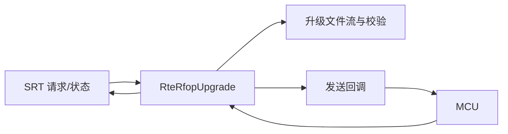

# 技术规范：MCU RFOP 固件升级任务

## 基本信息

| 字段 | 内容 |
|---|---|
| 规范编号 | 0300 |
| 父规范编号 | 无 |
| 所属模块 | MCU/RFOP |
| 关联功能 | 0300 - MCU 固件升级任务 |
| 创建日期 | 2026-08-03 |
| 状态 | 草稿（实现逆向基线） |

## 概述

RFOP 服务封装 MCU 升级任务，使用已校验升级文件流读取目标数据，通过注册的发送回调传输，维护任务状态/百分比/结果，并以 SRT 适配层读写请求和当前状态。

## 关联功能与验收来源

| 来源 | 内容 |
|---|---|
| 功能规范 | `0300-mcu-rfop-固件升级任务.spec.md` |
| 功能目标 | 创建、监控、取消 MCU 升级任务 |
| 验收标准 | [001]–[005]；本规范只定义技术路径 |

## 技术选型

### 选型对比

| 层级 | 技术 | 选择理由 |
|---|---|---|
| 服务 | RFOP server | 已有 MCU 通讯与调度边界 |
| 传输 | 回调注入发送函数 | 与具体串口/协议实现解耦 |
| 进度发布 | SRT 适配层 | 可被外部诊断/整包状态机读取 |

### 最终决策

沿用 RFOP 服务、可注入发送回调和 SRT 任务状态适配层。

## 架构设计

| 模块 | 职责 | 接口 |
|---|---|---|
| `rte_rfop_server` | 服务生命周期 | `RteRfopServer*` |
| `rte_rfop_upgrade` | 任务状态机和进度 | `StartTask/CancelTask/CurTask*` |
| `rte_rfop_upgrade_img` | 打开、摘要和升级项读取 | `TRteRfopUpgradeImgStream*` |
| `rte_rfop_upgrade_srt_adp` | 状态属性适配 | `Get/SetCurTask*` |

## API 设计

| 调用面 | 输入 | 输出/约束 |
|---|---|---|
| `RteRfopUpgradeSetSendDataMethod` | 发送函数与上下文 | 安装数据发送后端 |
| `RteRfopUpgradeStartTask` | 文件名、8 位任务 ID | 创建当前任务 |
| `RteRfopUpgradeCancelTask` | 任务 ID | 仅取消匹配任务 |
| `RteRfopUpgradeCurTask*` | 无 | 返回 ID、状态、进度、结果 |

## 数据模型

| 数据 | 字段 | 用途 |
|---|---|---|
| MCU 任务 | ID、状态、percent、result | 任务公开快照 |
| 升级文件流 | 文件、MD5、应用项索引 | 校验后分段读取 |
| SRT 属性 | 请求文件、开始/取消 ID、当前快照 | 外部控制和观察 |

## 部署架构

RFOP 服务与设备通信驱动同进程运行；升级文件可从本地文件系统读取；需要 SRT 服务与 MCU 通讯链路可用。

## 运行与验证条件

| 项目 | 内容 |
|---|---|
| 启动方式 | `RteRfopServerCreate/Init` 后循环 `RteRfopServerRunOnce` |
| 关闭方式 | `RteRfopServerDone/Destroy` |
| 自动验证入口 | 未发现独立自动测试 |
| 人工验收前置条件 | 可刷写 MCU、通信链路、有效升级文件及 SRT 可用 |

## 风险与决策

| 风险/决策 | 影响 | 处理方式 |
|---|---|---|
| 发送回调未设置/失败 | 无法传输 | 启动任务前检查后端，传播任务失败 |
| 文件在读取中被替换 | 校验与数据不一致 | 使用流创建后的校验结果并避免运行中替换 |

## 许可证检查清单

| 检查项 | 结果 |
|---|---|
| 是否新增开源依赖 | 否 |
| 现有依赖许可证 | RFOP、OFC 组件授权待项目审核确认 |
| 是否可商用 | 待确认现有组件授权 |
| 替代方案 | 不涉及新增选型 |

## 备注

代码证据：`rfop_server/rte_rfop_server/src/rte_rfop_upgrade.c:664`、`rfop_server/rte_rfop_server/src/rte_rfop_upgrade_srt_adp.h:32`。
