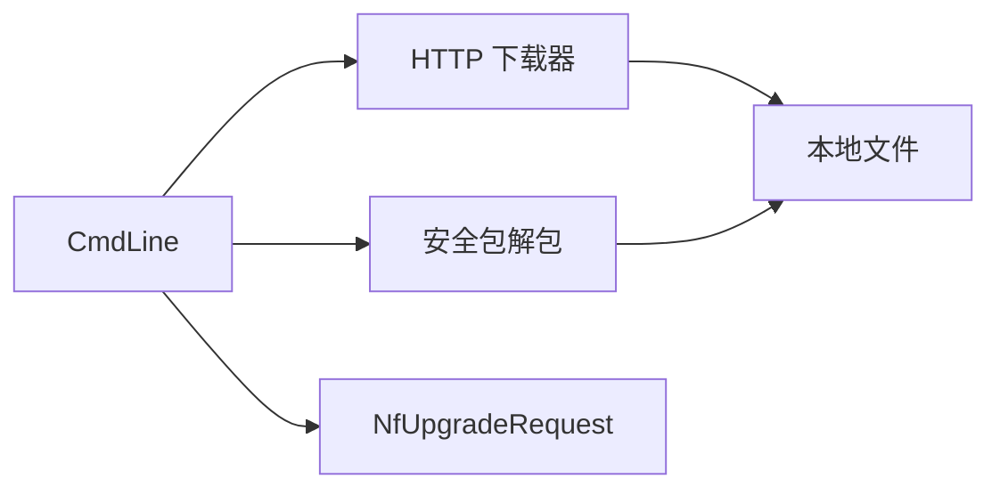

# 技术规范：命令行升级与网络包获取

## 基本信息

| 字段 | 内容 |
|---|---|
| 规范编号 | 0400 |
| 父规范编号 | 无 |
| 所属模块 | 运维交互 |
| 关联功能 | 0400 - 命令行升级与网络包获取 |
| 创建日期 | 2026-08-03 |
| 状态 | 草稿（实现逆向基线） |

## 概述

命令行解析 `--img`、`--url` 和 `--keys-dir`，按下载、解包、请求或查询顺序调度。内置下载器基于 socket 实现 HTTP URL 解析、连接超时、响应解析、目录创建、断点续传和进度回调。

## 关联功能与验收来源

| 来源 | 内容 |
|---|---|
| 功能规范 | `0400-命令行-升级与网络包获取.spec.md` |
| 功能目标 | 运维命令驱动包获取、处理和升级 |
| 验收标准 | [001]–[005] |

## 技术选型

### 选型对比

| 层级 | 技术 | 选择理由 |
|---|---|---|
| CLI | C 参数遍历 | 无额外运行时依赖 |
| 下载 | 原生 socket HTTP/1.x | 已实现连接、响应和续传控制 |
| 安全包 | `TSeImg` | 与既有安全包格式、密钥文件兼容 |

### 最终决策

沿用当前 C 命令行、原生 socket HTTP 下载器与安全包处理路径。

## 架构设计

| 模块 | 职责 | 接口 |
|---|---|---|
| `cmdline.c` | 参数解析和业务顺序 | `CmdLine`、`CmdDownloadImg` |
| `http_download.c` | HTTP 下载器 | `http_download_init/file/cleanup` |
| `se_img` | 安全包解包 | `CreateTSeImg`、`TSeImgUnpackImgToFile` |

## API 设计

| 调用面 | 输入 | 输出/约束 |
|---|---|---|
| `CmdLine` | `argc/argv` | 执行命令并返回结果 |
| `CmdDownloadImg` | URL、密钥目录 | 下载、可选解包 |
| `http_download_file` | URL/输出文件/超时/回调配置 | 成功或错误字符串 |

## 数据模型

| 数据 | 字段 | 用途 |
|---|---|---|
| `TCmdParams` | img、url、keys_dir | 命令工作上下文 |
| `http_download_options_t` | URL、输出、超时、续传、日志回调 | 下载控制 |
| URL 信息 | protocol、host、port、path | 连接与请求构造 |

## 部署架构

命令在设备 shell 运行，依赖可写升级介质和 HTTP 网络。安全包场景还依赖可读密钥目录；不引入 Web 服务端。

## 运行与验证条件

| 项目 | 内容 |
|---|---|
| 启动方式 | `hqupgrade --img <file>` 或 `hqupgrade --url <http-url>` |
| 关闭方式 | 命令返回后清理下载器资源 |
| 自动验证入口 | 未发现独立自动测试 |
| 人工验收前置条件 | 可访问 HTTP 服务、可写存储、可用测试升级包 |

## 风险与决策

| 风险/决策 | 影响 | 处理方式 |
|---|---|---|
| HTTP 明文传输 | 包来源安全风险 | 仅在受控网络使用；安全包需要走 0600 校验 |
| 磁盘空间不足 | 下载失败或残留文件 | 下载前检查容量应作为后续改进项 |
| 续传服务器不支持 Range | 下载无法续传 | 当前实现回退为从头下载 |

## 许可证检查清单

| 检查项 | 结果 |
|---|---|
| 是否新增开源依赖 | 否 |
| 现有依赖许可证 | 使用系统 socket；安全包组件授权待项目审核确认 |
| 是否可商用 | 待确认现有组件授权 |
| 替代方案 | 不涉及新增选型 |

## 备注

代码证据：`cmdline/cmdline.c:337`、`cmdline/http_download.c:136`、`cmdline/http_download.c:588`。
