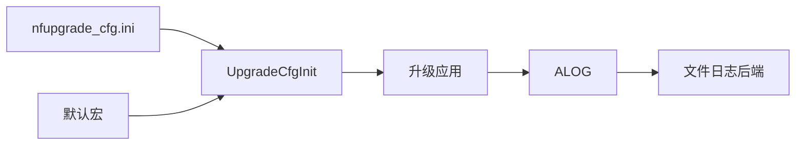

# 技术规范：升级运行配置与文件日志

## 基本信息

| 字段 | 内容 |
|---|---|
| 规范编号 | 0500 |
| 父规范编号 | 无 |
| 所属模块 | 运行保障 |
| 关联功能 | 0500 - 升级运行配置与文件日志 |
| 创建日期 | 2026-08-03 |
| 状态 | 草稿（实现逆向基线） |

## 概述

应用在启动阶段初始化全局 `TUpgradeCfg`。默认值内置于头文件，INI 成功读取后逐项覆盖。文件日志采用 `TAlogBackendFileImpl` 适配 ALOG 后端并维护大小、数量、标签和目录。

## 关联功能与验收来源

| 来源 | 内容 |
|---|---|
| 功能规范 | `0500-升级运行配置与文件日志.spec.md` |
| 功能目标 | 无重建配置升级运行参数并保留诊断日志 |
| 验收标准 | [001]–[005] |

## 技术选型

### 选型对比

| 层级 | 技术 | 选择理由 |
|---|---|---|
| 配置 | `cini` INI 解析 | 已有轻量本地配置依赖 |
| 默认回退 | 编译期宏 | 配置缺失时仍可启动 |
| 日志 | ALOG 文件后端 | 与既有日志框架对接 |

### 最终决策

沿用 INI 覆盖默认值与 ALOG 文件后端，不引入新的配置或日志依赖。

## 架构设计

| 模块 | 职责 | 接口 |
|---|---|---|
| `upgrade_app_cfg` | 默认值、INI 覆盖、全局读取 | `UpgradeCfgInit/Get` |
| `cini` | INI 键值解析 | `TCIniGetKeyValue*` |
| `a_log_backend_file_impl` | ALOG 回调写文件 | Create/Destroy/SetEnable |
| `file_log` | 文件写入与刷新 | `FileLogWrite/Flush/Done` |

## API 设计

| 调用面 | 输入 | 输出/约束 |
|---|---|---|
| `UpgradeCfgInit` | 可选 INI 路径 | 0 表示已加载；-1 仍保留默认配置 |
| `UpgradeCfgGet` | 无 | 只读全局配置 |
| `FileLogWrite` | 缓冲区和长度 | 写入当前日志 |
| `FileLogFlush` | 无 | 刷新数据 |

## 数据模型

| 数据 | 字段 | 用途 |
|---|---|---|
| `TUpgradeCfg` | 日志、NF/MPU 包、网络、使能项 | 全局运行配置 |
| INI 分组 | `log`、`nf_upgrade`、`mpu_upgrade`、`net_upgrade`、目标使能 | 可配置参数域 |
| 日志参数 | 目录、标签、单文件大小、数量 | 文件轮转行为 |

## 部署架构

默认配置路径为 `/vendor/app/hq/etc/nfupgrade_cfg.ini`；默认介质根路径为 `/media/card/`。日志与升级包路径必须由设备文件系统提供读写权限。

## 运行与验证条件

| 项目 | 内容 |
|---|---|
| 启动方式 | 进程启动时调用 `UpgradeCfgInit` |
| 关闭方式 | 结束时释放 ALOG/文件日志后端 |
| 自动验证入口 | 未发现独立自动测试 |
| 人工验收前置条件 | 有权限创建配置与日志目录 |

## 风险与决策

| 风险/决策 | 影响 | 处理方式 |
|---|---|---|
| 配置值不合法 | 路径、网络或日志异常 | 当前实现按可读取字段覆盖；后续应补充范围校验 |
| 存储满 | 日志或包写入失败 | 依赖日志数量/大小限制，部署时预留空间 |

## 许可证检查清单

| 检查项 | 结果 |
|---|---|
| 是否新增开源依赖 | 否 |
| 现有依赖许可证 | cini、ALOG、OFC 组件授权待项目审核确认 |
| 是否可商用 | 待确认现有组件授权 |
| 替代方案 | 不涉及新增选型 |

## 备注

代码证据：`common/upgrade_app_cfg.c:28`、`common/a_log_backend_file_impl.c:248`、`file_log/file_log.c:250`。
