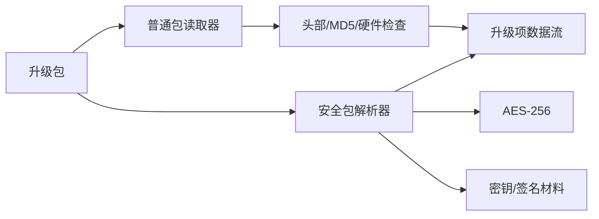

# 技术规范：升级包完整性校验与安全解包

## 基本信息

| 字段 | 内容 |
|---|---|
| 规范编号 | 0600 |
| 父规范编号 | 无 |
| 所属模块 | 包处理 |
| 关联功能 | 0600 - 升级包完整性校验与安全解包 |
| 创建日期 | 2026-08-03 |
| 状态 | 草稿（实现逆向基线） |

## 概述

普通 MCU 包由 `TImgUpgradeFile` 读取，执行头部、长度、MD5、硬件版本和升级项索引校验。安全包由 `TSeImg` 处理，使用 AES-256 封装、包头编码/解码与签名相关密钥文件解出目标内容。

## 关联功能与验收来源

| 来源 | 内容 |
|---|---|
| 功能规范 | `0600-升级包-校验与安全解包.spec.md` |
| 功能目标 | 阻止损坏、不匹配或无法验证的包进入升级 |
| 验收标准 | [001]–[005] |

## 技术选型

### 选型对比

| 层级 | 技术 | 选择理由 |
|---|---|---|
| 普通包完整性 | 自定义头 + MD5 | 已被 RFOP 文件流直接调用 |
| 安全包加密 | AES-256 包装器 | 当前源码已实现初始化、分段更新和结束 |
| 包格式 | DPT 编码/解码与 OTA 包头 | 已有固定二进制字段处理 |

### 最终决策

沿用现有包头、MD5、AES-256 和 DPT 处理链路，校验失败不得进入升级。

## 架构设计

| 模块 | 职责 | 接口 |
|---|---|---|
| `img_upgrade_file` | 普通包头、MD5、硬件和项读取 | `TImgUpgradeFile*` |
| `rte_rfop_upgrade_img` | RFOP 升级文件流封装 | `TRteRfopUpgradeImgStream*` |
| `se_img` | 安全包验证/解包 | `TSeImgIsValid/UnpackImgToFile` |
| `ofc_ase256` | AES-256 生命周期 | Init/Update/Final |
| `dpt_*` | 二进制字段编解码 | 读写整数和内存 |

## API 设计

| 调用面 | 输入 | 输出/约束 |
|---|---|---|
| `TImgUpgradeFileOpen` | 文件流、硬件版本输出 | 打开并验证可读包 |
| `TImgUpgradeFileCheckMd5` | MD5/硬件版本输出 | 校验完整性 |
| `TImgUpgradeFileReadItem` | 项索引、偏移、缓冲区 | 分段读取升级数据 |
| `TSeImgUnpackImgToFile` | 目标文件、读取回调 | 安全包解出结果 |

## 数据模型

| 数据 | 字段 | 用途 |
|---|---|---|
| `TImageHeader` | 包头、长度、版本、摘要相关字段 | 普通包合法性判断 |
| 升级项 | 目标设备、偏移、大小 | 定位发送数据 |
| OTA 包头消息 | 编码字段 | 安全包元数据 |
| AES 上下文 | 模式、密钥、IV、分段状态 | 加解密过程 |

## 部署架构

包处理在设备本地进程完成。安全包密钥默认来源可由运行配置指定；解包目标与临时文件路径必须具有受控访问权限。

## 运行与验证条件

| 项目 | 内容 |
|---|---|
| 启动方式 | 由命令行解包或 RFOP 创建升级文件流时调用 |
| 关闭方式 | 销毁文件流和安全包对象，关闭文件句柄 |
| 自动验证入口 | 未发现独立自动测试 |
| 人工验收前置条件 | 有效/损坏样本包、目标硬件版本、受控密钥材料 |

## 风险与决策

| 风险/决策 | 影响 | 处理方式 |
|---|---|---|
| 密钥泄露 | 安全包保护失效 | 密钥目录最小权限，禁止日志输出密钥 |
| 只校验头而未校验内容 | 可能刷写损坏数据 | 必须保留 MD5 与项读取校验路径 |
| 格式兼容变更 | 旧包无法升级 | 新格式需保留版本/兼容性验证 |

## 许可证检查清单

| 检查项 | 结果 |
|---|---|
| 是否新增开源依赖 | 否 |
| 现有依赖许可证 | AES-256 与 OFC 相关实现的授权待项目审核确认 |
| 是否可商用 | 待确认现有组件授权 |
| 替代方案 | 不涉及新增选型 |

## 备注

代码证据：`rfop_server/rte_terminal_ota/src/img_upgrade_file.c:116`、`rfop_server/se_img/src/se_img.c:464`、`rfop_server/se_img/src/ofc_ase256.c:33`。
