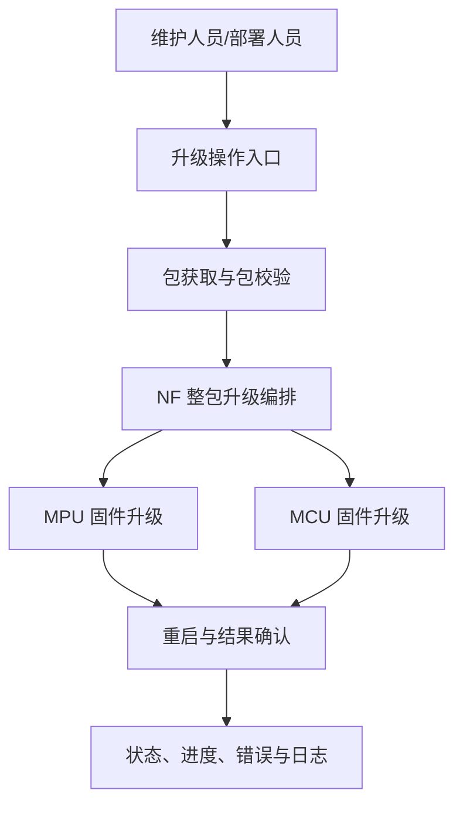

# mcu_upgrade_app 功能需求说明文档

## 文档头部

| 项目名称 | mcu_upgrade_app |
|---|---|
| 版本号 | 1.1.0 |
| 实施日期 | 2026-08-03 |
| 保密级别 | 内部使用 |
| 需求基线 | `az-sdd/spec/0100`–`0600`（实现逆向基线） |

### 更改记录

| 版本 | 日期 | 更改人 | 更改内容 |
|---|---|---|---|
| 1.0.0 | 2026-02-10 | AI | 初始版本 |
| 1.1.0 | 2026-08-03 | Codex | 以当前 SDD 功能规范重编：按六个横向功能域梳理需求、验收与约束；移除规范未证实的性能和协议承诺 |

## 1. 引言

### 1.1 目的

本文档说明 `mcu_upgrade_app` 的功能需求，为产品确认、开发维护、测试验收和技术支持提供统一的需求基线。内容严格来源于当前 SDD 功能规范，不将实现细节、未确认的性能指标或未来设想作为已交付需求。

### 1.2 范围

本文档覆盖完整 NF 升级编排、MPU 固件升级、MCU 固件升级、命令行与网络包获取、运行配置与文件日志、升级包校验与安全解包六个功能域。

不包含以下内容：新增图形界面、远程管理平台、未在 SDD 规范中确认的传输协议、精确性能指标或新的硬件平台支持。

### 1.3 目标读者

- 开发人员：确认既有功能的行为边界和后续修改影响。
- 测试人员：依据功能编号和验收要点设计设备测试。
- 项目管理人员：了解当前实现已覆盖的功能范围及待确认事项。
- 技术支持人员：了解升级准备、状态查询和异常处理要求。

### 1.4 术语说明

| 术语 | 解释说明 |
|---|---|
| MPU | 主处理器，承载系统主程序的处理器。 |
| MCU | 微控制器，承载外设或实时控制程序的处理器。 |
| NF 包 | 同时或分别包含 MPU、MCU 升级内容的完整升级包。 |
| RFOP | 本项目中用于 MCU 升级任务管理与数据传输的服务组件。 |
| SRT | 本项目用于发布和恢复升级任务状态的属性机制。 |
| 安全升级包 | 需使用受控密钥材料处理后才能得到升级文件的包。 |

### 1.5 引用文件说明

- [功能规范索引](../az-sdd/SPEC.md)
- [0100 NF 整包升级编排](../az-sdd/spec/0100-nf-整包升级编排.spec.md)
- [0200 MPU 固件升级与分区恢复](../az-sdd/spec/0200-mpu-固件升级与分区恢复.spec.md)
- [0300 MCU 固件升级任务](../az-sdd/spec/0300-mcu-rfop-固件升级任务.spec.md)
- [0400 命令行升级与网络包获取](../az-sdd/spec/0400-命令行-升级与网络包获取.spec.md)
- [0500 升级运行配置与文件日志](../az-sdd/spec/0500-升级运行配置与文件日志.spec.md)
- [0600 升级包完整性校验与安全解包](../az-sdd/spec/0600-升级包-校验与安全解包.spec.md)

### 1.6 项目背景

`mcu_upgrade_app` 运行于嵌入式设备，用于从本地文件或 HTTP 地址取得升级包，完成 MPU 和 MCU 固件升级，并向维护人员提供状态、进度、错误信息和日志。升级属于高风险操作，因此包校验、目标匹配、重启确认和掉电恢复是需求范围的一部分。

## 2. 总体架构设计

### 2.1 业务分层

### 2.2 功能需求总览表

| 功能编号 | 功能名称 | 子功能名称 | 优先级 | 功能描述 | SDD 来源 |
|---|---|---|---|---|---|
| FR-NF-001 | NF 整包升级 | 请求与预检查 | P0 | 接受新升级请求，校验完整升级包并识别升级目标 | 0100 |
| FR-NF-002 | NF 整包升级 | MPU/MCU 编排 | P0 | 按包内容执行 MPU、MCU 升级或跳过不存在目标 | 0100 |
| FR-NF-003 | NF 整包升级 | 重启确认与恢复 | P0 | 重启后确认结果；掉电后恢复待确认任务 | 0100 |
| FR-NF-004 | NF 整包升级 | 进度与取消 | P0 | 提供状态、百分比、错误码；支持取消进行中任务 | 0100 |
| FR-MPU-001 | MPU 固件升级 | 镜像升级 | P0 | 为已支持平台执行 MPU 镜像升级并反馈进度 | 0200 |
| FR-MPU-002 | MPU 固件升级 | 分区备份与恢复 | P0 | 按平台能力执行备份、回滚和分区状态查询 | 0200 |
| FR-MPU-003 | MPU 固件升级 | 重启确认 | P0 | 以重启后的确认结果判定升级成功或失败 | 0200 |
| FR-MCU-001 | MCU 固件升级 | 任务管理 | P0 | 以升级文件和任务 ID 启动、查询或取消 MCU 任务 | 0300 |
| FR-MCU-002 | MCU 固件升级 | 文件校验与传输 | P0 | 校验文件后传输升级数据，失败时不启动传输 | 0300 |
| FR-CLI-001 | 升级操作入口 | 本地包与网络包 | P1 | 使用命令提供本地包或 HTTP 地址取得升级包 | 0400 |
| FR-CLI-002 | 升级操作入口 | 安全包与状态查询 | P1 | 使用可选密钥目录处理安全包并查询升级状态 | 0400 |
| FR-CFG-001 | 运行配置与日志 | 配置回退与覆盖 | P1 | 配置缺失时使用默认值；有效配置覆盖运行参数 | 0500 |
| FR-CFG-002 | 运行配置与日志 | 文件日志 | P1 | 写入、刷新并按容量维护升级过程日志 | 0500 |
| FR-PKG-001 | 升级包处理 | 普通包校验 | P0 | 校验普通升级包的头部、完整性和目标匹配性 | 0600 |
| FR-PKG-002 | 升级包处理 | 安全包解包 | P0 | 使用受控密钥材料处理安全升级包 | 0600 |

## 3. 功能要求

### 3.1 NF 整包升级（FR-NF-001 ～ FR-NF-004）

#### 3.1.1 功能描述

系统应支持以完整升级包为输入，统一编排 MPU 和 MCU 的升级过程，并在全过程中提供可查询的任务状态。升级结果须经过重启后确认；在等待重启时掉电，重新启动后应恢复待确认任务。

#### 3.1.2 功能点

1. **请求与预检查（FR-NF-001）**
   - 仅在空闲、已成功或已失败状态接受新的升级请求。
   - 应校验完整升级包是否可读取、是否可通过预检查。
   - 包无效时不得进入刷写流程，并应报告失败原因。

2. **MPU/MCU 编排（FR-NF-002）**
   - 包中包含 MPU 内容时应执行 MPU 升级。
   - 包中包含 MCU 内容时应执行 MCU 升级。
   - 包中不包含某目标内容时应跳过该目标，不应因其缺失而误执行升级。

3. **重启确认与掉电恢复（FR-NF-003）**
   - 升级完成后应等待设备重启，并确认 MPU、MCU 的最终结果。
   - 任一升级或确认步骤失败时，任务应形成失败结果。
   - 在等待重启阶段掉电后，系统重新启动应恢复升级标记并继续确认。

4. **状态、进度与取消（FR-NF-004）**
   - 应可查询当前任务 ID、状态、0–100 的进度百分比和错误码。
   - 取消请求仅对进行中的任务有效；取消后任务应进入失败状态。

### 3.2 MPU 固件升级与分区恢复（FR-MPU-001 ～ FR-MPU-003）

#### 3.2.1 功能描述

系统应支持为已构建的 MPU 平台设置镜像路径，执行升级、备份或回滚，并可查询升级状态、进度和平台支持的分区信息。

#### 3.2.2 功能点

1. **镜像升级（FR-MPU-001）**
   - 镜像路径必须非空且长度合法；非法路径应被拒绝。
   - 应在空闲状态接受升级请求，升级过程中返回状态和进度。
   - 超时不应导致无限等待，应形成明确的完成或失败结果。

2. **分区备份与恢复（FR-MPU-002）**
   - 平台需要时，应先执行备份后再进入刷写。
   - 应支持平台可用的回滚操作。
   - 支持的平台应可查询活动分区及另一分区是否损坏。

3. **重启确认（FR-MPU-003）**
   - 升级完成并不等于升级成功。
   - 只有重启后的确认成功，才能形成升级成功结论；确认超时或失败应形成失败结论。

### 3.3 MCU 固件升级任务（FR-MCU-001 ～ FR-MCU-002）

#### 3.3.1 功能描述

系统应以 MCU 升级文件和任务 ID 管理一项升级任务，在传输前完成文件校验，并公开当前任务状态、百分比和结果。

#### 3.3.2 功能点

1. **任务管理（FR-MCU-001）**
   - 有效的升级文件和任务 ID 可创建 MCU 升级任务。
   - 应可查询当前任务 ID、状态、百分比和最终结果。
   - 对当前有效任务应支持取消；取消后任务应停止并发布结果。

2. **文件校验与传输（FR-MCU-002）**
   - 文件不能打开、头部不匹配或完整性摘要不匹配时，任务不得开始传输。
   - 校验通过后应可按升级项读取数据并用于 MCU 升级。
   - MCU 升级结束后，应能被整包升级流程用于后续重启确认。

### 3.4 命令行升级与网络包获取（FR-CLI-001 ～ FR-CLI-002）

#### 3.4.1 功能描述

维护人员应能通过命令提供本地升级包或 HTTP 地址，并可选提供密钥目录。系统应完成下载、必要的安全包处理、升级请求提交或状态查询。

#### 3.4.2 功能点

1. **本地包与网络包（FR-CLI-001）**
   - 命令应至少提供本地包或网络地址之一；均未提供时应报告参数无效。
   - HTTP 下载应支持连接超时、重试、进度显示和已下载内容续传。
   - 下载失败时应输出可诊断信息。

2. **安全包与状态查询（FR-CLI-002）**
   - 未提供密钥目录时，普通包可直接进入后续升级处理。
   - 提供完整密钥目录时，安全包应先被处理为可升级文件。
   - 查询模式不要求提供包或地址，且应显示当前升级状态、进度和错误码。

### 3.5 升级运行配置与文件日志（FR-CFG-001 ～ FR-CFG-002）

#### 3.5.1 功能描述

部署人员应能通过配置文件调整升级包、网络、日志与 MPU/MCU 使能项；配置文件缺失不应阻断应用运行。维护人员应能通过文件日志获取升级过程和异常信息。

#### 3.5.2 功能点

1. **配置回退与覆盖（FR-CFG-001）**
   - 配置文件不存在或读取失败时，应使用默认路径、默认升级包和默认日志参数。
   - 有效的日志、升级包、网络和使能项配置应覆盖对应默认值。
   - 禁用 MPU 或 MCU 后，完整升级不应处理被禁用目标。

2. **文件日志（FR-CFG-002）**
   - 日志启用时，运行消息应写入指定目录，且可刷新和关闭。
   - 日志达到配置容量时，应按配置数量维护可用日志文件。

### 3.6 升级包完整性校验与安全解包（FR-PKG-001 ～ FR-PKG-002）

#### 3.6.1 功能描述

系统应在升级前校验普通 MCU 升级文件或处理安全升级包，确保包未损坏、目标硬件匹配，且只有通过验证的数据可进入升级传输或刷写。

#### 3.6.2 功能点

1. **普通包校验（FR-PKG-001）**
   - 普通包只有在头部、长度和完整性摘要校验通过时才可读取升级项。
   - 目标硬件信息不匹配时，系统应拒绝该文件。
   - 任何校验失败都不得向后续升级提供有效数据。

2. **安全包解包（FR-PKG-002）**
   - 安全包处理需要受控的密钥材料。
   - 密钥材料可用且解包过程完整时，应生成后续升级使用的目标文件。
   - 摘要、头部、签名或解包失败时，应阻断升级。

## 4. 非功能性需求

### 4.1 可靠性需求

1. 升级结论应以重启确认结果为准，不能仅以刷写完成作为成功结论。
2. 在等待重启阶段掉电后，系统应恢复待确认任务。
3. 无效包、文件校验失败、超时或确认失败时，系统应形成可查询的失败结果并阻断后续刷写。

### 4.2 安全与兼容性需求

1. 安全升级包的密钥材料必须来自受控目录。
2. 目标硬件版本不匹配的升级文件必须被拒绝。
3. MPU 升级仅适用于当前构建所支持的平台。
4. 网络包获取范围限定为当前已支持的 HTTP 下载能力；是否支持其他协议不在本需求基线内。

### 4.3 可观测性与可维护性需求

1. 升级过程中应能读取任务 ID、状态、百分比、错误码或最终结果。
2. 应提供升级过程文件日志，并支持通过配置调整日志位置和容量。
3. 配置缺失时应使用默认值继续运行，避免因可选配置缺失阻断升级应用。

### 4.4 待确认项

以下指标未在当前 SDD 功能规范中定义，不能作为本版本验收条件；如需纳入交付，应先补充并审核相应规范：

- 状态查询的最大响应时间、升级速度、CPU/内存占用阈值。
- 升级成功率、重试次数、长时间稳定运行时长。
- 访问控制策略及命令执行权限模型。
- HTTP 以外的网络协议支持范围。

## 5. 异常处理

### 5.1 异常分类及处理策略

| 异常类型 | 异常描述 | 处理策略 | 用户可见结果 |
|---|---|---|---|
| 升级包异常 | 包不可读、头部/摘要无效或硬件不匹配 | 不进入刷写或传输 | 失败状态与错误信息 |
| MPU 升级异常 | 路径非法、状态非法、超时或确认失败 | 停止当前升级并形成失败结论 | 状态、进度和错误结果 |
| MCU 升级异常 | 文件校验失败、传输失败或取消 | 不启动/停止任务并发布结果 | 当前任务状态和最终结果 |
| 网络下载异常 | 连接、传输或续传失败 | 重试；仍失败则返回诊断信息 | 命令失败信息 |
| 配置异常 | 配置文件缺失或读取失败 | 使用默认配置继续运行 | 运行日志中的诊断信息 |
| 掉电异常 | 等待重启期间掉电 | 重启后恢复待确认任务 | 后续确认状态 |

## 6. 配置项汇总

| 配置类别 | 可配置内容 | 默认行为 | 需求说明 |
|---|---|---|---|
| 日志 | 日志目录、标签、单文件大小、保留数量 | 使用默认日志参数 | 控制日志写入位置和容量 |
| NF 升级包 | 普通包与安全包路径 | 使用默认升级包路径 | 指定完整升级包来源 |
| MPU 升级 | 镜像路径、分区记录路径 | 使用默认路径 | 指定 MPU 升级所需文件 |
| 网络包 | 下载使能、地址格式、密钥目录和相关属性标识 | 使用默认网络参数 | 控制网络包获取与安全包材料位置 |
| 升级使能 | MCU、MPU 使能项 | 默认均启用 | 决定整包升级是否包含对应目标 |

## 7. 测试建议

### 7.1 功能测试

1. **NF 整包升级**：分别验证双目标包、仅 MPU 包、仅 MCU 包、无效包、状态查询、取消和重启确认。
2. **掉电恢复**：在等待重启阶段断电并重启，验证任务恢复至对应确认步骤。
3. **MPU 升级**：在每个已支持平台验证合法/非法镜像路径、进度、超时、分区查询以及平台可用的备份或回滚。
4. **MCU 升级**：验证任务创建、状态查询、取消、文件头/摘要损坏拦截和正常数据传输。
5. **命令行与网络包**：验证本地包、HTTP 下载、中断后续传、下载失败、安全包处理和查询模式。
6. **配置与日志**：验证默认配置回退、有效配置覆盖、目标使能项、日志写入、刷新和容量维护。
7. **包校验与安全解包**：验证普通包完整性、硬件匹配、安全包密钥材料完整/缺失和错误包拦截。

### 7.2 可靠性测试

1. 验证升级、传输、重启确认失败时均不会被误报为成功。
2. 验证升级中重复请求、非法路径和取消请求的边界行为。
3. 验证日志目录不可写、存储不足和配置缺失时的可诊断行为。

### 7.3 验收追溯

功能验收项和 MT 用例以六份 SDD 功能规范为准；本说明文档用于汇总与需求确认，不替代各规范内的验收契约。

## 8. 总结与建议

### 8.1 总结

`mcu_upgrade_app` 的当前需求基线围绕“可信升级包 → 升级编排 → MPU/MCU 执行 → 重启确认 → 状态与日志”形成完整闭环。系统支持本地与 HTTP 获取升级包、普通包与安全包处理、配置化运行和升级中的掉电恢复。

### 8.2 建议

1. 审核 0100–0600 的草稿状态，确认当前实现是否就是产品验收口径。
2. 为未定义的性能、权限、重试和协议范围建立独立 SDD 规范后，再纳入可验收需求。
3. 建立可在目标硬件上执行的自动化或半自动化测试入口，减少升级高风险场景对纯人工测试的依赖。

### 8.3 结论

本文档是当前代码和 SDD 功能规范的一致性需求说明。任何新增功能、改变验收口径或引入新的运行约束，都应先更新对应 SDD 功能规范并完成审核。
