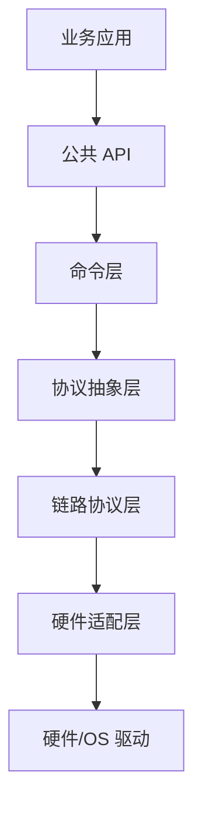

# {{产品或 SDK 名称}} API 接口分层架构总结

## 文档信息

| 项目 | 说明 |
|---|---|
| 原始资料 | {{源文档列表}} |
| SDK/产品版本 | {{版本}} |
| 目标读者 | {{audience}} |
| 总结范围 | {{scope}} |
| 篇章格式参考 | {{reference_document_or_none}} |

## 术语表

### 容易混淆的概念

| 概念 | 不是什么 | 在本 SDK/项目中的含义 |
|---|---|---|
| 加密 | 不等于签名 | {{context}} |
| HASH | 不等于 MAC | {{context}} |
| key_id | 不等于用户/进程/会话 ID | {{context}} |
| 会话密钥 | 不等于业务 session_id | {{context}} |

### 系统与架构术语

| 术语 | 英文/全称 | 上下文含义 |
|---|---|---|
| {{term}} | {{full_name}} | {{context_meaning}} |

### 通信与协议术语

| 术语 | 英文/全称 | 上下文含义 |
|---|---|---|
| {{term}} | {{full_name}} | {{context_meaning}} |

### 密钥、算法、模式和数据格式术语

| 术语 | 类型/全称 | 上下文含义 |
|---|---|---|
| {{term}} | {{type_or_full_name}} | {{context_meaning}} |

## 目录

{{toc}}

## 1. 引言

### 1.1 目的

{{purpose}}

### 1.2 接口统计

| 层次/模块 | 前缀 | 数量 | 业务是否直接调用 |
|---|---|---:|---|
| {{layer}} | `{{prefix}}` | {{count}} | {{direct_use}} |

## 2. 分层架构



| 层次 | 职责 | 主要文件/模块 |
|---|---|---|
| {{layer}} | {{responsibility}} | {{files}} |

## 3. 公共 API

### 3.1 {{模块名称}}

#### 函数概览

| API | 说明 | 关键限制 |
|---|---|---|
| `{{api_name}}` | {{description}} | {{constraints}} |

#### 接口原型

```c
{{prototypes}}
```

#### 参数和返回值

{{parameter_and_return_notes}}

## 4. 内部命令层

| 内部接口 | 说明 | 对应公共 API |
|---|---|---|
| `{{internal_api}}` | {{description}} | `{{public_api}}` |

## 5. 协议抽象与链路层

{{protocol_layers}}

## 6. 硬件适配层

| 移植接口 | 作用 | 目标平台映射 |
|---|---|---|
| `{{port_api}}` | {{description}} | {{platform_mapping}} |

## 7. 核心数据结构和错误模型

| 类型 | 关键字段 | 用途 |
|---|---|---|
| `{{type}}` | {{fields}} | {{usage}} |

## 8. 推荐调用流程

{{recommended_flows}}

## 9. 项目能力映射

| 项目能力 | SDK API | 状态/说明 |
|---|---|---|
| {{project_capability}} | `{{sdk_api}}` | {{status}} |

## 10. 关键限制和安全提示

1. {{security_or_usage_constraint}}

## 附录：完整 API 索引

{{complete_api_index}}

